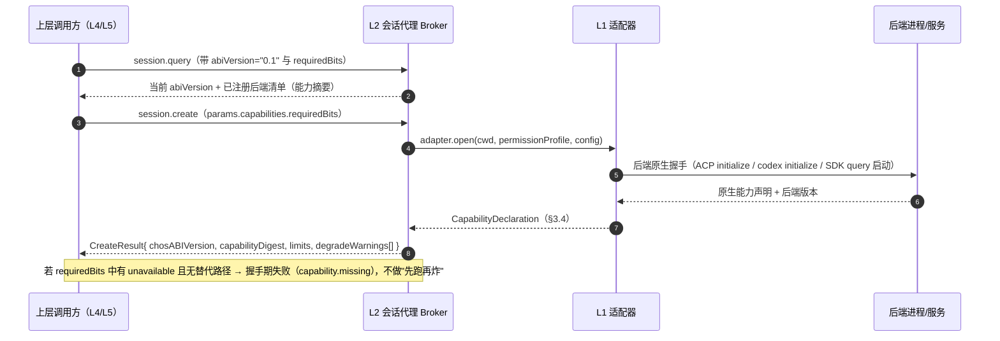

# ABI v0 —— MOCL 兼容层内部协议（唯一命名真源）

> 本文是 **D4 的协议契约**，也是全项目**事件名 / 错误码 / 能力位 / 方法名**的唯一登记表。
> 其他文档（`docs/architecture/*`、`docs/adapters/*`、`docs/integration/*`、`docs/risk/*`、`docs/test/*`）**必须引用本文**，不得另起同义命名。
> ABI 定义「语义」；**传输层（ACP / app-server / Agent SDK）只是绑定方式**，见 §4。适配器如何把某后端原生字段映射到本文事件，属 `docs/adapters/*`（D5 写域），本文只给契约与必填字段。

- 版本：**`abiVersion = "0.1"`**（MAJOR.MINOR，见 §2）
- 状态：design-frozen（本设计阶段冻结；施工阶段只能按 §13 的兼容规则增量演进）
- 依赖事实基线：`.astra/CONTEXT-DSH-SEAM.md`、`docs/research/{codex,claude-code,kimi,opencode}.md`、`docs/research/capability-matrix.md`
- JSON Schema：`docs/abi/schema/{session,event,error,capabilities,request}.json`（§12）

---

## 0. 命名约定（强制）

| 种类 | 形式 | 正则 | 示例 |
|---|---|---|---|
| 能力位 | camelCase | `^[a-z][a-zA-Z0-9]*$` | `resumeSession`、`tokenLevelStream` |
| 方法名 | `namespace.verb`（verb 小写）+ 可选 camelCase 复合词 | `^[a-z][a-z0-9]*\.[a-zA-Z][a-zA-Z0-9]*$` | `session.create`、`session.setMode` |
| 事件类型 | `domain.kebab-event` | `^[a-z][a-z0-9]*(\.[a-z][a-z0-9-]*)+$` | `turn.completed`、`session.state-changed` |
| 错误码 | `category.kebab-code` | `^[a-z][a-z0-9]*(\.[a-z][a-z0-9-]*)+$` | `quota.rate-limited`、`transport.frame-too-large` |
| 幂等键 | 不透明字符串，建议 UUIDv7/ULID | `^[A-Za-z0-9_-]{8,128}$` | `01J9Z...` |
| 逻辑会话 id | `sess_` + ULID(Crockford) | `^sess_[0-9A-HJKMNP-TV-Z]{26}$` | `sess_01J9ZQ8K3M4N5P6Q7R8S9T0V1W` |

规则：

1. 事件名、错误码**只增不改**；改名 = 新类型 + 旧类型进入 deprecated（§13）。
2. 事件名/错误码大小写敏感。**禁止**把后端原生事件名直接透传（如 `item/agentMessage/delta`、`session/update`）。原生名只允许出现在适配器内部与 `docs/adapters/*` 的映射表左列。
3. 一个概念只有一张表：能力位在 §3，方法在 §6，事件在 §7，错误码在 §8。其他文档引用章节号，不复制。
4. 时间戳一律 **RFC 3339 UTC 毫秒**（`2026-10-25T13:54:07.123Z`）；时长一律毫秒整数；字节数一律十进制整数。
5. 未知字段：请求方**禁止**发送未定义字段（`additionalProperties:false`）；接收方必须忽略未知字段（前向兼容），但必须记录 `abi.warning` 级诊断。

---

## 1. 设计立场（与 DEC-1 的关系）

ABI 只定义**控制面语义**：会话身份、生命周期、能力协商、事件归一化、错误分类、幂等。它**不规定**传输、不规定进程模型、不规定后端实现。

- **内部 ABI 自研**（DEC-1 推荐）：因为四个后端的产品面分别是 ACP（kimi/opencode）、app-server JSON-RPC（codex）、Agent SDK（claude），三套语义差异集中在「会话身份、续接、中断、权限应答、事件粒度、错误形态」六个点；统一这六个点的收益远大于分别适配的上层重复成本。
- **传输层按后端选择**：ACP 用于 kimi，**opencode = v2 HttpApi 优先 + ACP 兜底（LEDGER D-007）**，app-server 用于 codex，Agent SDK 用于 claude；ABI 在 L1 适配器之上收敛，L0 只认字节/帧。
- ABI 与 DSH 无关：L4 负责把 ABI 投影到 DSH seam，L4 的细节属 `docs/integration/*`（D6 写域），本文只约定 L4 必须消费/产生的 ABI 对象。

---

## 2. 版本协商

### 2.1 版本号语义

`abiVersion` 形如 `"MAJOR.MINOR"`：

| 变更 | 规则 | 处置 |
|---|---|---|
| MINOR +1 | 只增字段/只增枚举值/只增能力位 | 旧客户端必须忽略未知项（前向兼容） |
| MAJOR +1 | 删字段、改语义、改必填、改错误码含义 | 必须双栈期并存（§13） |

当前 **`0.1`**。`0.x` 期间 MINOR 变更视为**可破坏但需公告**（施工期先例：仍按 MAJOR 流程处理双栈，见 §13.3）。

### 2.2 三阶段握手



协商算法（确定性，可单测）：

1. 调用方发 `abiVersion` 与 `requiredBits[]`（可空）。缺省 `abiVersion` 时按 `0.1` 处理。
2. Broker 选择 `min(双方 MAJOR 相同且最大 MINOR)`；MAJOR 不同 → `protocol.version-mismatch`，**不做猜测式降级**。
3. Broker 合并后端声明：`bit.state ∈ {native, emulated, unavailable}`（§3.3）。
4. 对每个 `requiredBits` 项：
   - `native` / `emulated` → 通过（`emulated` 记入 `degradeWarnings[]`，由 L4 决定是否提示父级）；
   - `unavailable` → 若 §3.5 降级表存在**替代路径**，替换为该路径并返回 `substitutions[]`；否则返回 `capability.missing`，附 `missingBits[]`。
5. 每个方法调用可再带 `requiredBits`（方法级），语义同上，用于「运行中出现能力缺口」时提前拒绝而不是挂起。

### 2.3 后端原生版本协商（不属于 ABI，但 ABI 要求其结论）

适配器必须在 ABI 的 `CapabilityDeclaration` 中回填**可核验的原生版本与协议版本**，并对不匹配**快速失败**：

| 后端 | 原生握手/版本断言 | 失败分类码 |
|---|---|---|
| codex | `initialize` + `clientInfo`；二进制版本必须与钉住的 bundle 版本一致（本机 0.153.4 vs PATH 0.164.0 双版本，见 `docs/research/codex.md` §6-1） | `protocol.version-mismatch` |
| claude-code | SDK `0.3.263` + **SDK 内置 CLI `2.1.263`** 组合断言（宿主 CLI `2.1.310` 属另一条升级线，默认不用）；`init.claude_code_version`（stream 模式下首轮 `send` 内断言） | `protocol.version-mismatch` |
| kimi | ACP `protocolVersion`（实测仅支持 `1`）；`agentInfo.version` | `protocol.version-mismatch` |
| opencode | ACP `protocolVersion`（实测 `1`）；`agentInfo.version`；v2 HttpApi `info.version` | `protocol.version-mismatch` |

`versionPinning` 能力位（§3.2）的 `state=unavailable` 表示**无法可靠断言版本**；此时 Broker 在 `CapabilityDeclaration.warnings[]` 中强制记一条，并要求 L4 在父级可见信息中提示「后端版本未钉住」。

---

## 3. 能力位（Capability Bits）

### 3.1 双组结构

- **A 组（15 位）**：与 `docs/research/capability-matrix.md` 的 15 个能力维度**一一对应**，保证矩阵与 ABI 不产生第二套词汇。
- **B 组（19 位）**：ABI 运行期真正需要协商、但矩阵不单列的细分能力（续接形态、流式粒度、权限应答、子会话透传等）。

### 3.2 唯一能力位表

| # | 能力位 | 组 | 语义（ABI 视角） | 无此位时的默认行为 |
|---|---|---|---|---|
| 1 | `headless` | A | 可无 TTY、无人工交互地执行一轮 | 拒绝接入（`capability.missing`） |
| 2 | `streaming` | A | 提供**过程事件**（至少 message/tool 级），非只有最终结果 | 只能拿终态结果，L3 无增量可折叠 |
| 3 | `resumeSession` | A | 可按持久化后端会话 id 续接后续轮次 | 见 §3.5 R-1 |
| 4 | `forkSession` | A | 可从既有会话分叉出新会话 | 不能分叉；恢复只能续接或重建 |
| 5 | `listSessions` | A | 可枚举后端侧会话 | 只能列举 Broker 自身注册表 |
| 6 | `interruptTurn` | A | 可中断进行中的一轮且保留会话可用 | 退化为进程级中断（§3.5 I-1） |
| 7 | `nativeSubagents` | A | 后端存在原生子代理/子会话编排面 | 兼容层不承诺子代理树，只透传 |
| 8 | `toolExtension` | A | 可扩展工具/MCP/skill/plugin | 权限与工具面收窄，不自动适配 |
| 9 | `permissionModes` | A | 有可选的权限/审批模式集合 | 只能走「拒绝一切需审批动作」 |
| 10 | `sandboxModes` | A | 有后端级沙箱/只读模式 | 由外层 worktree + 只读策略兜底 |
| 11 | `modelRouting` | A | 可按会话/轮次指定模型或 provider | 用后端默认模型 |
| 12 | `concurrencyControl` | A | 后端**声明并强制**并发上限 | 上限只能由 Broker 本地强制（可能超卖） |
| 13 | `usageReporting` | A | 提供 token/成本/时长用量 | 无用量，只有时长；成本不可观测 |
| 14 | `structuredProtocol` | A | 有稳定的机器可读协议（非解析文本） | 拒绝接入（文本解析不进入 v0） |
| 15 | `versionPinning` | A | 可断言并钉住后端版本 | 记 warning，允许接入但标注风险 |
| 16 | `multiTurn` | B | 同一后端会话可承载**多轮** prompt/answer | 每轮都要新建会话（成本与上下文损失） |
| 17 | `steerTurn` | B | 运行中追加输入/转向 | 只能排队到下一轮 |
| 18 | `inputInbox` | B | 运行中输入队列（可列、可取消） | 无队列，运行中发送返回 `session.locked` |
| 19 | `tokenLevelStream` | B | token/fragment 级增量（不只是消息级） | 只有消息级增量 |
| 20 | `planUpdates` | B | 提供结构化计划更新 | 计划文本混在 message 中 |
| 21 | `diffUpdates` | B | 提供结构化改动/diff 增量 | 改动只在工具结果里 |
| 22 | `tokenUsage` | B | 轮次级 token 用量事件 | 只有终态累计（若 `usageReporting`） |
| 23 | `permissionAutoReply` | B | 可程序化应答权限请求且无需人工 | 需人工 → 无人值守下默认拒绝（`policy.permission-denied`） |
| 24 | `permissionRequestBridge` | B | 有稳定的「服务端→客户端」反向请求通道 | 权限不可应答，只能靠模式裁剪 |
| 25 | `childSessionUpdates` | B | 子会话（原生子代理）事件可被父会话接收 | 子代理只有终态汇总或不可见 |
| 26 | `sessionArchive` | B | 可归档后端会话 | 只归档 Broker 侧记录 |
| 27 | `sessionUnarchive` | B | 可取消归档 | 归档即不可恢复（`session.invalidated`） |
| 28 | `sessionDelete` | B | 可删除后端会话 | 只能本地 tombstone，后端残留 |
| 29 | `sessionExport` | B | 可导出会话转写 | 只能导出 Broker 事件日志 |
| 30 | `sessionReseed` | B | 可新建会话并注入交接摘要（恢复兜底） | 恢复失败即终态 |
| 31 | `worktreeIsolation` | B | 可声明/创建 worktree 隔离 | 由外层负责 worktree |
| 32 | `backgroundRuns` | B | 支持后台会话/服务常驻 | 只支持前台进程生命周期 |
| 33 | `processKillInterrupt` | B | 中断只能杀进程且**杀后可续接** | 杀进程即丢会话（`session.aborted` + 不可续） |
| 34 | `handshakeVersion` | B | 握手中可读取后端版本（用于 §2.3 断言） | 版本只能从二进制/包元数据读，不可核验 |

> 位名即契约：`docs/adapters/*` 的能力矩阵必须使用本表 1–15 列名（A 组）与 `docs/research/capability-matrix.md` 行名对齐；适配器额外声明 B 组位。

### 3.2.1 与「能力矩阵派生表 B（12 位建议）」的对照（消解命名分歧）

`docs/research/capability-matrix.md` §3 给的是**输入建议**（明确写「最终定义权与 JSON Schema 在 D4」）。最终 ABI 采用本表 34 位，原因与对照如下：

| 矩阵建议位 | ABI 最终位 | 差异说明 |
|---|---|---|
| `canStream` | `streaming` | 同义；ABI 名对齐事件 `message.delta` 的语义 |
| `canResume` | `resumeSession` | 同义 |
| `canFork` | `forkSession` | 同义 |
| `canListSessions` | `listSessions` | 同义 |
| `canInterrupt` | `interruptTurn` | 同义；另加 `processKillInterrupt` 表达「只能杀进程且杀后可续」 |
| `hasNativeSubagents` | `nativeSubagents` | 同义；子会话事件可观测性拆出 `childSessionUpdates` |
| `canExtendTools` | `toolExtension` | 同义 |
| `hasPermissionModes` | `permissionModes` | 同义；可自动应答拆出 `permissionAutoReply` / `permissionRequestBridge` |
| `hasOsSandbox` | `sandboxModes` | 语义收窄为「后端可声明的沙箱/只读模式」，OS 级与否由适配器 `detail` 说明 |
| `canRouteModel` | `modelRouting` | 同义 |
| `hasHardConcurrencyCap` | `concurrencyControl` | 同义（是否可声明并强制上限） |
| `hasUsageMetrics` | `usageReporting` | 同义；token 级细节拆出 `tokenUsage` |
| （矩阵认为不必设位）`headless` | `headless`（A 组，**准入位**） | 矩阵理由成立：全后端 ✅，为 false 等于不可编排。ABI 仍保留位，是为了让 `requiredBits` 能显式表达「准入门槛」；`unavailable` = 握手期拒绝，不是降级 |
| （矩阵认为不必设位）`structured-protocol` | `structuredProtocol`（A 组，**准入位**） | 同上；矩阵用 `protocolSchema` 元数据表达「可导出/仅录制」，ABI 保留布尔准入位 + `detail` 记录证据强度 |
| （矩阵认为不必设位）`version-pinning` | `versionPinning`（A 组，**告警位**） | 矩阵用 `pinnedVersion/versionAssert` 实例字段；ABI 保留位以表达「能否断言」，`unavailable` 只告警不断言可用 |

**保留 A 组 1:1 的理由**：15 个能力行是 `check_docs.py matrix` 的机器可判维度，ABI 与它同名同序可以让「矩阵行 ↔ 能力位 ↔ 适配器声明 ↔ 测试断言」四者不经翻译地对应；矩阵的 12 位建议是子集+异名，若直接采用会引入两套词汇。B 组 19 位是 ABI 运行期真正需要的细分（续接形态、流式粒度、权限应答、子会话透传、恢复兜底、worktree、后台运行、握手版本），矩阵未覆盖。

### 3.3 能力声明的状态与质量

`CapabilityDeclaration.bits` 是**数组**（每项 `{bit, state, detail?, constraint?}`），不是动态键对象——数组形态可被 JSON Schema 逐项校验、可排序 diff、不会因为新增能力位而破坏 `additionalProperties:false`：

```json
{ "bit": "resumeSession", "state": "native", "detail": "thread/resume + ~/.codex/sessions rollout", "constraint": "需先 thread/read 探测版本" }
```

- `state = native`：后端原生提供，语义与 ABI 一致。
- `state = emulated`：由 L1/L2 用替代路径模拟，**语义会有可观测差异**，必须写 `detail`，并计入 `degradeWarnings[]`。
- `state = unavailable`：不可用，且**不得**在运行期才暴露；必须在握手中声明。

`CapabilityDeclaration` 另含：`backendId`、`backendVersion`、`transport`、`nativeProtocolVersion`、`limits`、`warnings[]`、`observedAt`。Schema 见 `docs/abi/schema/capabilities.json`。

### 3.4 能力声明样例（示意，非实测值）

```json
{
  "abiVersion": "0.1",
  "backendId": "codex",
  "backendVersion": "0.153.4",
  "transport": "app-server-jsonrpc",
  "nativeProtocolVersion": "0.153.4-appserver",
  "bits": [
    { "bit": "headless", "state": "native" },
    { "bit": "streaming", "state": "native", "detail": "item/*Delta" },
    { "bit": "resumeSession", "state": "native", "detail": "thread/resume" },
    { "bit": "forkSession", "state": "native", "detail": "thread/fork + lastTurnId" },
    { "bit": "interruptTurn", "state": "native", "detail": "turn/interrupt" },
    { "bit": "multiTurn", "state": "native" },
    { "bit": "tokenLevelStream", "state": "native", "detail": "item/*Delta" },
    { "bit": "permissionAutoReply", "state": "native", "detail": "10 个 method 的 ServerRequest 需逐条预注册" },
    { "bit": "childSessionUpdates", "state": "native", "detail": "collabAgentToolCall" },
    { "bit": "sandboxModes", "state": "native" }
  ],
  "limits": { "maxTurnMs": 1800000, "idleTimeoutMs": 180000, "maxSessionsPerBackend": 8,
              "maxNestingDepth": 2, "maxConcurrentTurns": 3 },
  "warnings": [],
  "observedAt": "2026-10-25T13:54:07.123Z"
}
```

### 3.5 「能力缺失 → 优雅降级」总表（本 ABI 的核心验收点）

> 原则：**能力缺失在握手期变成一条明确的降级路径，而不是运行期的报错。** 每条降级都要回答三件事：替代路径是什么、父级看到什么差异、什么情况下才允许报错。

| ID | 缺失位 | 替代路径 | 父级可观测差异 | 允许报错的条件 |
|---|---|---|---|---|
| R-1 | `resumeSession` | 若 `sessionReseed=native/emulated`：新建会话 + 交接摘要（`reseed`）；否则保留事件日志，会话转 `aborted`，`preservedThroughSeq` 标出可读范围 | 续接=新会话；历史不连续；成本可能翻倍 | 连 `reseed` 都无且调用方要求 `requiredBits:["resumeSession"]` → `capability.missing`（握手期） |
| R-2 | `forkSession` | 只用续接；或复制当前会话摘要后新建（若 `sessionReseed`） | 无法保留原会话与分叉历史 | 调用方显式要求 fork → `capability.missing` |
| R-3 | `interruptTurn` | 若 `processKillInterrupt`：杀进程 + 立即按 R-1 恢复；否则只能把会话置 `aborted` 并放弃会话 | 中断延迟变大；同进程内其他会话可能被连带终止（kimi 实测：ACP 单进程多会话） | 调用方要求「中断后同会话可继续」→ `capability.missing` |
| R-4 | `multiTurn` | 每轮 `session.create` 并在 `params.seed` 注入上轮摘要 | 延迟↑、成本↑、上下文保真度↓ | 调用方要求「同会话连续轮」→ `capability.missing` |
| R-5 | `tokenLevelStream` | 只发消息级 `message.delta`；L3 折叠窗口按消息级重算 | 流式颗粒变粗，父级进度更稀疏 | 不报错（能力降级，非故障） |
| R-6 | `permissionAutoReply` | 无人值守下**默认拒绝**所有需审批动作；把「被拒绝的工具调用」作为 `tool.failed` + `policy.permission-denied` 上报 | 任务可能因缺权限而部分完成 | 调用方要求 `mode=yolo/auto` 且声明 `requiredBits:["permissionAutoReply"]` → `capability.missing` |
| R-7 | `permissionRequestBridge` | 仅靠启动参数/配置文件静态裁剪（如 `--tools`、`permission.rules`、只读模式） | 无法按单次调用动态放行 | 出现运行期需人工放行的动作 → `policy.escalation-required` |
| R-8 | `listSessions` | 只用 Broker 注册表（含 tombstone） | 看不到 Broker 外部创建的会话 | 要求「发现外部会话」→ `capability.missing` |
| R-9 | `usageReporting` | 只报时长与事件计数；`usage.updated` 发 `{estimated:true, usage:null}` 语义的占位 | 无 token/成本，无法做预算硬控 | 调用方要求成本硬门禁 → `limit.budget-exceeded` 前先 `capability.missing` |
| R-10 | `sessionUnarchive` | 归档视为不可恢复；`session.invalidated` | 归档后不可续接 | 调用方要求「归档后可恢复」→ `capability.missing` |
| R-11 | `sessionReseed` | 恢复失败即 `aborted`（保留事件） | 会话终止，需人工重派 | 调用方 `requiredBits:["sessionReseed"]` → `capability.missing` |
| R-12 | `sandboxModes` | 外层 worktree + 只读命令白名单；非只读档位要求显式 `danger-full-access` + 隔离 | 隔离强度下降，需人工确认 | 调用方要求「后端级只读」硬保证 → `capability.missing` |
| R-13 | `concurrencyControl` | Broker 本地硬上限（可能超卖后端额度） | 后端侧可能 429 增多 | 不报错（降级），429 走 §8 `quota.rate-limited` |
| R-14 | `childSessionUpdates` | 子代理只上报终态 `child.completed`；中间过程折叠进父会话摘要 | 无子代理实时树 | 调用方要求实时子代理树 → `capability.missing` |
| R-15 | `steerTurn` | 排队到下一轮；运行中发送返回 `session.locked` | 无法即时转向 | 调用方要求运行中转向 → `capability.missing` |
| R-16 | `worktreeIsolation` | 外层先建 worktree 再以该 cwd 启动后端 | 隔离责任转移到调用方 | 调用方要求隔离且未提供 cwd → `policy.sandbox-violation` |
| R-17 | `planUpdates` / `diffUpdates` | 不产生对应事件；文本混在 `message.*` 中 | 无结构化计划/改动面板 | 不报错（降级） |
| R-18 | `backgroundRuns` | 前台进程；断开即 `lost` → 冷恢复 | 无跨客户端共享会话 | 调用方要求后台常驻 → `capability.missing` |
| R-19 | `headless` / `structuredProtocol` | **无替代路径**（v0 明确拒绝） | — | 接入即 `capability.missing` |

**两条硬规则**：

1. **R-1 是必测路径**：任意后端 `resumeSession=unavailable` 时，`session.recover` 必须走「reseed 或 aborted」二选一，且两次调用返回同一结果（幂等），不得抛裸异常。
2. 降级必须是**声明式**的：`CreateResult.substitutions[]` 与 `degradeWarnings[]` 由 Broker 在握手时一次性给出；运行期**禁止**临时切换替代路径（运行期只允许进入 `blocked` 并等待上层决策）。

---

## 4. 传输绑定（transport bindings）

ABI 不绑传输。v0 允许四种绑定，L0 负责实现，L1 只依赖绑定接口。**绑定是会话级选择**（同一后端可同时开多个绑定），能力位可带 `constraint: "requires http-api channel"` 之类的通道前置条件：

| 绑定 | 用于 | 帧/流形态 | 请求关联 | 取消/中断 | 版本断言 |
|---|---|---|---|---|---|
| `acp-stdio` | kimi、opencode | **逐行 JSON-RPC 2.0**（无 Content-Length 头） | JSON-RPC `id` | ACP `session/cancel`（若后端不支持则进程信号） | `initialize.protocolVersion` + `agentInfo.version` |
| `app-server-jsonrpc` | codex | JSON-RPC 2.0 over stdio/unix/ws；`codex app-server --listen` | JSON-RPC `id` | `turn/interrupt` | `initialize` + 二进制版本断言 |
| `agent-sdk` | claude-code | in-process async iterable（SDK 拉起 CLI 子进程） | SDK `query()` 返回对象 + control request | `Query.interrupt()` | CLI `--version` + `init.claude_code_version` |
| `cli-stream-json`（兜底） | kimi（备）、opencode（备） | 子进程 stdout JSONL，**单向**、消息级 | 无多路复用；一次进程一次调用 | 进程信号 | `--version` |
| `http-api` | **opencode 主通道**（v2 HttpApi；与 `acp-stdio` 构成双通道，D-007；见 `docs/research/capability-matrix.md` §2） | HTTP JSON + SSE（`/api/event`，`data: {json}` + heartbeat 注释） | HTTP 请求/响应 + SSE `id` | `POST /api/session/{id}/interrupt?resume=` | `GET /api/info` 的 `version`；HTTP Basic 鉴权必须由 L0 注入（不得读明文密码后打印） |

**绑定选择结论**（与能力矩阵一致）：codex = `app-server-jsonrpc`（备 `cli-stream-json`）；claude-code = `agent-sdk`（备 `cli-stream-json`）；kimi = `acp-stdio`（备 `cli-stream-json`）；**opencode = `http-api` 优先 + `acp-stdio` 兜底（双通道，D-007）**——ACP 不提供中断/自动批准/运行中切模型（矩阵 C2 已判定以「通道 + 实测」为准），这些能力位必须标 `constraint: "http-api"`，否则就是虚假声明。

绑定层必须提供的最小抽象（L1 可见）：`open()`、`request(method, params, timeoutMs)`、`notify(method, params)`、`onNotification(handler)`、`onReverseRequest(handler)`、`close()`、`health()`。**禁止**上层感知 JSON-RPC 的 `id` 分配与帧格式。

绑定的三条 ABI 级要求：

1. **反向请求必须可应答**：ACP 的 `fs/read_text_file`、`fs/write_text_file`、`terminal/*`、`session/request_permission`；codex 的 10 个 method `ServerRequest`（8 现代 + 2 v1 legacy）；claude 的 `canUseTool`/hooks。L1 必须为每类注册确定性应答（默认拒绝/只读允许），**不允许「无 handler → 静默挂起」**（kimi 实测：不实现 `fs/read_text_file` 时 `session/prompt` 永久静默挂住）。
2. **超时是传输层义务**：每个 `request` 都有独立 timeout；无内置超时的后端方法（如 kimi `session/prompt`）必须由 L0/L1 强制总超时。
3. **坏帧隔离**：单帧解析失败不得杀死连接，只记录 `transport.frame-invalid` 并继续；连续 N 帧失败（默认 5）升级为 `protocol.bad-frame` 并重建连接。

---

## 5. 消息模型

### 5.1 请求 / 响应

```json
{
  "abiVersion": "0.1",
  "requestId": "01J9ZQ8K3M4N5P6Q7R8S9T0V1W",
  "method": "session.send",
  "sessionId": "sess_01J9ZQ8K3M4N5P6Q7R8S9T0V1W",
  "clientRequestId": "01J9ZR1A2B3C4D5E6F7G8H9J0K",
  "epoch": 3,
  "requiredBits": ["streaming"],
  "params": { "input": [{ "type": "text", "text": "..." }], "expect": "turn" }
}
```

- `requestId`：链路级唯一（UUIDv7/ULID），仅用于日志关联与响应匹配，**不进入幂等账本**。
- `clientRequestId`：**幂等键**，见 §9。只读方法可省略。
- `epoch`：调用方看到的最新 fencing token；Broker 会拒绝过期 epoch 的写操作（`session.conflict`）。
- 响应：成功 `{"ok":true,"result":{...},"deduplicated":false}`；失败 `{"ok":false,"error":{...}}`（error 见 §8）。
- 错误响应**不携带**后端原始堆栈/凭据/绝对路径之外的敏感内容；`details` 只允许结构化字段（见 `error.json`）。

### 5.2 事件信封（冻结）

```json
{
  "abiVersion": "0.1",
  "eventId": "01J9ZR2B3C4D5E6F7G8H9J0K1M",
  "sessionId": "sess_01J9ZQ8K3M4N5P6Q7R8S9T0V1W",
  "turnId": "turn_01J9ZR2B3C4D5E6F7G8H9J0K1M",
  "seq": 42,
  "epoch": 3,
  "ts": "2026-10-25T13:54:07.123Z",
  "type": "message.delta",
  "backend": { "id": "kimi", "version": "2.3.1" },
  "payload": { "channel": "assistant", "text": "OK", "granularity": "message" }
}
```

事件不变量：

| 编号 | 不变量 |
|---|---|
| EV-1 | `(sessionId)` 内 `seq` **严格单调 +1**，跨 epoch 继续递增（不重置）；消费者发现 gap → 调 `session.replay` 补齐。 |
| EV-2 | `eventId` 全局唯一；同一 `(sessionId, seq, epoch)` 的重复投递必须被消费者按 `eventId` 去重（至少一次投递）。 |
| EV-3 | `epoch` 只增；收到 `epoch < 本地已知 epoch` 的事件必须丢弃并记 `abi.warning`（防止旧连接复活污染状态）。 |
| EV-4 | 一轮内顺序：`turn.started` → (`message.*` / `reasoning.*` / `tool.*` / `plan.updated` / `diff.updated`) → `turn.completed` 或 `turn.failed` 或 `turn.aborted`；终态事件后不得再有该 `turnId` 的事件。 |
| EV-5 | `session.state-changed` 必须携带 `previousState` 与 `state`，且在引发它的业务事件**之后**发出。 |
| EV-6 | 事件必须先持久化到 L2 journal 再投递到 L3（write-ahead），否则冷恢复无法重放。 |

---

## 6. 方法清单

### 6.1 总表（唯一）

| # | 方法 | 类型 | 幂等键 | 必需能力位（缺则按 §3.5 降级/拒绝） | 说明 |
|---|---|---|---|---|---|
| M1 | `abi.negotiate` | 读 | — | — | 取 ABI 版本与后端能力摘要（§2.2） |
| M2 | `session.create` | 写 | `clientRequestId` 必填 | `headless`,`structuredProtocol` | 建会话（可选首轮） |
| M3 | `session.send` | 写 | `clientRequestId` 必填 | — | 发一轮输入 |
| M4 | `session.resume` | 写 | `clientRequestId` 必填 | `resumeSession`（否则 §3.5 R-1） | 续接既有后端会话并可选发一轮 |
| M5 | `session.interrupt` | 写 | `clientRequestId` 必填 | `interruptTurn`（否则 R-3） | 中断进行中一轮 |
| M6 | `session.query` | 读 | — | — | 查单会话状态/最后 seq/结果 |
| M7 | `session.list` | 读 | — | — | 列举（支持状态/backend/父会话过滤） |
| M8 | `session.recover` | 写 | `clientRequestId` 必填 | 视策略（R-1/R-11） | 冷恢复（探测 + 重连 + 重放） |
| M9 | `session.close` | 写 | `clientRequestId` 必填 | — | 关闭/释放资源（幂等） |
| M10 | `session.fork` | 写 | `clientRequestId` 必填 | `forkSession`（否则 R-2） | 从既有会话分叉 |
| M11 | `session.archive` | 写 | `clientRequestId` 必填 | — | 归档（后端可选，`sessionArchive`） |
| M12 | `session.respond` | 写 | `clientRequestId` 必填 | `permissionRequestBridge`（否则 R-7） | 应答权限/输入请求 |
| M13 | `session.steer` | 写 | `clientRequestId` 必填 | `steerTurn`（否则 R-15） | 运行中转向/追加 |
| M14 | `session.setMode` | 写 | `clientRequestId` 必填 | `permissionModes` | 切权限/计划模式 |
| M15 | `session.setModel` | 写 | `clientRequestId` 必填 | `modelRouting` | 切模型/推理档 |
| M16 | `session.subscribe` | 流 | — | `streaming` | 订阅事件（从 seq 起） |
| M17 | `session.replay` | 读 | — | — | 按 seq 区间重放事件（冷恢复/断线补偿） |
| M18 | `sys.ping` | 读 | — | — | 心跳/活性探针 |

### 6.2 关键方法契约

**M2 `session.create`**

```json
// params
{
  "backendId": "codex",
  "cwd": "/abs/path",                       // 必填；相对路径一律拒绝（policy.sandbox-violation）
  "label": "review PR #42",
  "parentSessionId": null,                  // 嵌套时填；深度由 Broker 校验
  "permissionProfile": "read-only",         // read-only | safe-auto | yolo（默认 read-only）
  "model": null, "reasoningEffort": null,
  "capabilities": { "requiredBits": ["resumeSession"], "preferredBits": ["tokenLevelStream"] },
  "limits": { "maxTurnMs": 1800000, "maxNestingDepth": 2 },
  "firstInput": { "input": [{"type":"text","text":"..."}], "expect": "turn" } // 可选
}
// result
{
  "sessionId": "sess_...",
  "state": "created",
  "backendSessionId": "0199...|null",       // 后端尚未建好时 null，created→running 时回填
  "remoteIdState": "pending|bound",         // D-020：id 是否已回填（缺省视为 bound）；见 §6.2 会话对象
  "abiVersion": "0.1",
  "capabilityDigest": { "resumeSession": "native", "...": "..." },
  "substitutions": [],
  "degradeWarnings": [],
  "limits": { "...": 0 },
  "deduplicated": false
}
```

- 副作用：分配 `sess_` id → journal 写 intent → L1 open → 后端建会话（可选首轮）→ journal 写 ack。
- 失败：若首轮失败但会话已建，返回 `state=created` + `turnId` 失败事件，**不吞掉会话**（可 `session.query` 再决定 close/续接）。
- 幂等：同 `clientRequestId` 重放返回**同一** `sessionId` 与 `deduplicated:true`；不允许创建第二个后端会话。

**M3 `session.send`**

```json
// params
{
  "input": [{"type":"text","text":"..."}],
  "expect": "turn",                          // turn（默认）| continue（同会话下一轮）
  "delivery": "caller",                      // caller（同步等结果）| parent（完成时通知）
  "turnLimits": { "maxTurnMs": 1800000, "maxOutputTokens": null },
  "seedSummary": null                        // 仅 R-4 降级重开时使用
}
// result
{ "turnId": "turn_...", "acceptedAtSeq": 42, "state": "running", "deduplicated": false }
```

- 同一会话**最多一个进行中轮**（turnLock）；并发 `session.send` → `session.locked`（可重试，带 `retryAfterMs`）。
- 幂等：同 `clientRequestId` 重放 → 返回同一 `turnId`；若原轮已完成，额外返回 `resultRef`，**绝不重发**。
- 该方法的错误可能异步到达（turn 失败）：同步只表示「已接受」。调用方以事件为准。

**M4 `session.resume`**

```json
// params
{ "backendSessionId": "0199...", "fromSeq": 108, "input": null, "expect": "turn" }
// result
{ "sessionId": "sess_...", "state": "running", "resumedFromSeq": 108, "epoch": 4, "deduplicated": false }
```

- 语义边界：**常规下一轮**用 `session.send(expect=continue)`（L1 内部会续接，不暴露给上层）；`session.resume` 用于**跨进程/冷恢复/显式重连**（需给 `backendSessionId` 与 `fromSeq`）。
- 守卫：`state ∈ {completed, blocked, aborted?}` 或 `lost/recovering` 的探测成功；`running/awaiting-input` 下调用 → `session.conflict`（请用 `send`/`steer`）。
- `fromSeq`：调用方最后确认的事件序号；Broker 先 `session.replay` 补齐再续接，保证事件不跳号。
- 若 `resumeSession=unavailable` → 必须按 §3.5 R-1 返回 `substitutions:["reseed"]` 并走新建路径；**不得**直接抛 `protocol.unknown-method`。

**M5 `session.interrupt`**

```json
// params
{ "turnId": "turn_...", "reason": "user-cancel" }
// result
{ "turnId": "turn_...", "state": "aborted", "interruptMethod": "native|process-kill", "deduplicated": false }
```

- 幂等：已中断/已完成 → 返回当前状态 + `deduplicated:true`，不报错。
- `interruptMethod` 必须如实上报（`process-kill` 时父级可见「中断可能丢失当前轮内容」）。

**M8 `session.recover`**（冷恢复入口，详细算法见 `docs/architecture/02-state-machine.md` §6）

```json
// params
{ "reason": "lease-expired|process-crash|broker-restart|manual", "strategy": "auto|resume|fork|reseed|abort", "fromSeq": 108 }
// result
{ "sessionId": "sess_...", "state": "recovering|running|aborted", "recovery": { "attempt": 2, "strategy": "resume", "resumedFromSeq": 108, "replayedEvents": 7, "epoch": 4 }, "deduplicated": false }
```

- 策略缺省 `auto`：`resume` → `fork`（若调用方要求隔离）→ `reseed` → `abort`，**任一步成功即停**；成功率与尝试次数写入 `recovery`。
- 幂等：同一 `(sessionId, epoch, strategy)` 重放返回同一结果；不同策略并发调用 → 后者 `session.locked`。
- 失败语义：返回 `ok:false` + 明确分类码（`session.invalidated` / `session.resume-failed` / `capability.missing`），**不隐藏**；会话状态同步落到 `aborted`/`blocked` 并发出事件。

**M9 `session.close`**：幂等关闭；重复调用返回 `{closed:true, alreadyClosed:true}`；不删除 journal 与事件（归档/删除是 M11/后端行为）。

**M16/M17 事件订阅与重放**：`session.subscribe {fromSeq}` 先补历史再转实时；断线重连带 `lastSeq`，保证 exactly-once 消费语义由消费者去重（EV-2）实现。

**会话对象 `remoteIdState`（D-020，v0 唯一的会话对象新增字段）**

`session.create` / `session.query` / `session.list` 返回的会话对象含可选字段 `remoteIdState: "pending" | "bound"`（**缺省视为 `bound`**，以兼容既有样例）：

| 值 | 含义 | Broker 守卫 |
|---|---|---|
| `pending` | 后端会话 id 尚未产生（例：kimi CLI 兜底通道首轮前 `remoteSessionId` 为空） | 只允许 `session.send` 等待首轮回填；**禁止** `session.resume`（无 id 可探测），冷恢复按 §3.5 R-1 走 reseed/重开 |
| `bound` | 已有后端 id，可按 id 探测/续接 | 正常执行 §3.5 R-1 探测流程 |

- 回填时机：首轮 `session.resume_hint` / `session.recovered`（或后端输出中首次出现会话 id）→ Broker 持久化并置 `bound`；空 id 不得被当作"会话丢失"（`session.not-found`）。
- 字段真源：`docs/abi/schema/session.json#/properties/remoteIdState`；语义背景见 `docs/adapters/kimi.md` §4.5。

---

## 7. 事件清单（唯一）

> 事件名即契约。适配器必须产出本表事件；**无法映射的原生事件**必须丢弃并在适配器内部计数（`abi.warning` 级诊断），不得伪造 ABI 事件。

### 7.1 生命周期

| 事件 | payload 必填字段 | 语义/触发 | 频率建议 |
|---|---|---|---|
| `session.created` | `backend`, `state`, `cwd`(脱敏) | 逻辑会话建立（后端会话可能尚未建好） | 1/会话 |
| `session.state-changed` | `previousState`, `state`, `reason` | 状态机转移（EV-5） | 每转移 1 条 |
| `session.recovered` | `epoch`, `recovery:{strategy,attempt,replayedEvents}` | 冷恢复成功 | 每恢复 1 条 |
| `session.lost` | `reason`, `lastKnownSeq` | 失联（输出中断、会话未终止） | 每失联 1 条 |
| `session.closed` | `reason` | 主动关闭 | 1/会话 |
| `session.archived` | `reason` | 归档 | 1/会话 |
| `session.warning` | `code`, `message`, `degrade` | 非致命降级（能力 emulated、事件丢弃、限流丢弃） | 折叠后 ≤1/窗口 |

### 7.2 轮次

| 事件 | payload 必填字段 | 语义/触发 |
|---|---|---|
| `turn.started` | `turnId`, `inputDigest`, `model` | 一轮开始（后端已接受） |
| `turn.completed` | `turnId`, `stopReason`, `usage?` | 正常结束（`stopReason ∈ end-turn,max-turns,stop-sequence,other`） |
| `turn.failed` | `turnId`, `error:{code,message}` | 失败结束（错误码取 §8） |
| `turn.aborted` | `turnId`, `interruptMethod` | 被中断 |
| `turn.steered` | `turnId`, `steerSeq` | 运行中转向被接受 |
| `turn.queued` | `turnId`, `queuePosition` | 输入进入队列（`inputInbox`） |

### 7.3 消息与推理

| 事件 | payload 必填字段 | 语义/触发 | 折叠提示 |
|---|---|---|---|
| `message.started` | `channel ∈ {assistant,system,tool}`, `messageId` | 消息开始 | 保留 |
| `message.delta` | `channel`, `text`, `granularity ∈ {token,message}` | 文本增量（可能为零长度：仅心跳） | L3 按窗口合并 |
| `message.completed` | `channel`, `messageId`, `text`（完整） | 消息完成（**以本事件为权威文本**，delta 可丢） | 保留 |
| `reasoning.delta` | `text`, `granularity` | 思考增量 | 默认不进父会话 |
| `reasoning.summary` | `text` | 思考摘要（后端提供时） | 可折叠为 1 条/轮 |

### 7.4 工具

| 事件 | payload 必填字段 | 语义/触发 | 折叠提示 |
|---|---|---|---|
| `tool.started` | `toolCallId`, `name`, `kind?` | 工具调用开始 | 计数折叠 |
| `tool.progress` | `toolCallId`, `text?`, `percent?` | 输出/参数增量（可能高频） | 丢弃优先 |
| `tool.completed` | `toolCallId`, `status ∈ {ok,error,denied}`, `outputDigest`, `output?` | 工具成功（`output` 超上限只给摘要+artifact） | 保留 |
| `tool.failed` | `toolCallId`, `error:{code,message}` | 工具失败 | 保留 |

### 7.5 计划 / 改动 / 用量

| 事件 | payload 必填字段 | 语义 |
|---|---|---|
| `plan.updated` | `planId?`, `steps:[{id,title,status}]` | 结构化计划快照（全量，非增量） |
| `diff.updated` | `files:[{path,status,additions?,deletions?}]`, `patch?` | 改动快照（全量；`patch` 超上限只给 digest） |
| `usage.updated` | `usage:{inputTokens?,outputTokens?,reasoningTokens?,costUsd?,durationMs?}`, `estimated` | 用量快照（轮次或累计，`scope` 标明） |

### 7.6 权限与输入

| 事件 | payload 必填字段 | 语义 |
|---|---|---|
| `permission.requested` | `requestId`, `tool`, `risk`, `options:[{id,kind}]`, `summary` | 后端请求权限（无人值守下由策略自动应答） |
| `permission.resolved` | `requestId`, `decision ∈ {allow-once,allow-always,deny,cancel}`, `by ∈ {policy,user}` | 权限结论（含自动拒绝） |
| `input.requested` | `requestId`, `question`, `options?` | 后端请求人工输入（无人值守默认拒绝/占位） |
| `input.resolved` | `requestId`, `decision ∈ {answered,declined,timeout}` | 输入结论 |

### 7.7 子会话（原生子代理）

| 事件 | payload 必填字段 | 语义 |
|---|---|---|
| `child.spawned` | `childSessionId`, `nativeAgentId?`, `name?`, `depth` | 子会话创建 |
| `child.state-changed` | `childSessionId`, `previousState`, `state` | 子会话状态（含终态） |
| `child.completed` | `childSessionId`, `status`, `summary?` | 子会话结束（无 `childSessionUpdates` 时的唯一可见信号） |

### 7.8 传输与诊断

| 事件 | payload 必填字段 | 语义 |
|---|---|---|
| `transport.state-changed` | `transport`, `state ∈ {connecting,ready,degraded,closed,failed}`, `detail?` | L0 连接状态 |
| `diagnostic.log` | `level ∈ {debug,info,warn,error}`, `message`, `component` | 结构化诊断（**绝不包含凭据**，见 §10） |
| `progress.folded` | `window:{startMs,endMs}`, `items:[{kind,text,count?,key}],` `dropped:{count,kinds[]}`, `chars`, `truncated` | L3 → L4 的父会话增量载体（§11） |

### 7.9 事件与状态映射

- `session.state-changed` 是唯一权威状态信号；`session.lost`/`session.recovered` 是它的**辅助证据事件**（先发专用事件，再发 state-changed）。
- `turn.*` 终态必须恰好一个；缺失 → `session.lost`（失联）或 `turn.failed`（由恢复对账补齐，见 02 文档 §6）。
- 事件可由 L2 在恢复后**补发**（重放）；补发事件保留原 `seq/ts`，但 `eventId` 不变，消费者按 EV-2 去重。

---

## 8. 错误分类树与错误码

### 8.1 分类树（顶层 12 类）

```text
error
├── transport.*   连接/帧/超时（对端没说话或说不清）
├── auth.*        认证与凭据（身份不被接受）
├── quota.*       限流与额度（429 / 余额 / 上下文窗口）
├── protocol.*    协议与版本（说清了但不合规/不匹配）
├── process.*     子进程生命周期（崩溃/挂起/拉起失败）
├── capability.*  能力缺失（协商不到位）
├── session.*     会话语义（不存在/失效/冲突/映射损坏）
├── policy.*      权限与沙箱（被策略拦下）
├── storage.*     本地持久化（写到一半/写不下/写坏了）
├── limit.*       上限（嵌套/并发/预算/轮次时长）
├── security.*    安全（凭据泄漏征兆等）
└── internal.*    兼容层自身缺陷（兜底，必须带 traceId）
```

> 分类树保持 12 类；`backend.internal-error` 的 `category=internal`（见 §8.2 表下注）。

### 8.2 错误码总表（唯一）

| 错误码 | 类别 | 可重试性 | 典型触发/检测 | 默认处置 | 用户可见提示（中文，≤60 字） |
|---|---|---|---|---|---|
| `transport.connect-failed` | transport | 重试退避（≤2） | spawn 失败、socket 拒绝、握手前 EOF | 换绑定（若声明备通道）→ 仍失败则 fail | 后端进程启动失败，正在重试/已切换备用通道 |
| `transport.disconnected` | transport | 恢复重连 | pipe EOF、ws close、子进程退出但无终态事件 | `lost` → 冷恢复 | 与后端的连接中断，正在恢复会话 |
| `transport.timeout` | transport | 仅幂等读/写 | request 超时（默认 30s；长轮次用 `maxTurnMs`） | 查询对端实际状态后再决定，禁止盲目重发 | 后端响应超时，正在核对会话状态 |
| `transport.frame-invalid` | transport | 否（同字节重试无意义） | 单帧 JSON 解析失败、行协议缺换行 | 丢弃该帧 + 计数，连续 5 次升级 | 收到无法解析的后端消息，已隔离 |
| `transport.frame-too-large` | transport | 否 | 单帧 > `maxFrameBytes`（默认 1 MiB） | 拒绝该帧；若为事件超限则截断+artifact | 后端消息过大，已截断处理 |
| `transport.backpressure` | transport | 等待/丢弃低优 | 输出缓冲 > 高水位、消费者慢 | 丢弃可折叠事件（§11 优先级），保留终态 | 后端输出过快，进度已折叠 |
| `auth.missing-credential` | auth | 否 | 后端报告未登录/无凭据 | fail fast，`blocked` | 后端未配置凭据，请先登录对应产品 |
| `auth.credential-expired` | auth | 否（需刷新） | 401/`api_key_expired`/OAuth 过期 | 若有 refresh 能力尝试 1 次，否则 fail | 后端凭据已过期，请重新登录 |
| `auth.credential-rejected` | auth | 否 | 403/invalid key | fail fast，不循环重试（防锁定） | 后端拒绝凭据，请检查配置 |
| `auth.login-required` | auth | 否（无人值守） | ACP `authMethods` 仅终端登录、未登录 | fail fast，提示需人工登录 | 需要人工登录后端（无人值守不可代答） |
| `auth.provider-mismatch` | auth | 否 | 模型/套餐对本 integrator 不可用 | fail fast，提示换模型/provider | 当前模型对后端不可用，请更换模型 |
| `quota.rate-limited` | quota | 是（尊重 `Retry-After`，退避+抖振，≤5 次） | HTTP 429、ACP 错误体含 rate | 暂停该会话；其他会话仍可跑 | 后端限流，正在退避重试 |
| `quota.usage-exhausted` | quota | 否（需充值/换号） | 余额/额度耗尽 | `blocked`，停止派发 | 后端额度已耗尽，请补充额度 |
| `quota.context-overflow` | quota | 否（同输入） | 上下文窗口超限 | 降级：压缩/分叉/重开（视能力） | 上下文超出窗口，已尝试压缩/重开 |
| `protocol.unknown-method` | protocol | 否 | JSON-RPC -32601 | 能力降级（§3.5）或 fail | 后端不支持该操作，已切换降级路径 |
| `protocol.invalid-params` | protocol | 否 | -32602、参数校验失败 | fail（兼容层缺陷），记 traceId | 请求参数不被后端接受（内部错误） |
| `protocol.version-mismatch` | protocol | 否 | ABI/后端版本断言失败 | fail fast，禁止混跑 | 版本不匹配，已阻止启动 |
| `protocol.bad-frame` | protocol | 有条件 | 连续坏帧、乱序 id、未知 id | 重建连接；会话转 `lost` 后恢复 | 协议异常，正在重建连接 |
| `protocol.unexpected-response` | protocol | 有条件 | 重复 id、迟到响应、类型不符 | 隔离并记诊断，不改变状态 | 收到意外响应，已忽略并记录 |
| `process.spawn-failed` | process | 重试退避（≤2） | ENOENT/EACCES、二进制缺失 | 换路径/换绑定 → fail | 后端可执行文件无法启动 |
| `process.crashed` | process | 恢复重试 | 非零退出/信号且轮次未完成 | `lost` → 冷恢复（R-1） | 后端进程崩溃，正在恢复会话 |
| `process.hung` | process | 恢复重试 | 心跳超时 + 无输出 > `idleTimeoutMs` | 先探测，再杀进程 + 恢复 | 后端无响应，正在重启恢复 |
| `process.killed` | process | 否（预期） | 兼容层主动 SIGTERM/SIGKILL | 按中断语义结束 | 后端进程已终止 |
| `capability.missing` | capability | 否 | `requiredBits` 全为 unavailable 且无替代 | 握手期拒绝，附 `missingBits` | 后端缺少必需能力：<bits> |
| `capability.unsupported-method` | capability | 否 | 适配器无该后端方法映射 | 拒绝并提示降级路径 | 后端不支持该方法，请改用降级路径 |
| `session.not-found` | session | 否 | 未知 `sessionId`（本地无记录/tombstone 已 GC） | fail，附可用列表 | 会话不存在或已过期 |
| `session.invalidated` | session | 否（可 reseed） | 后端报 not-found/已删除/已归档且不可恢复 | 按 R-1/R-10/R-11 降级；默认 `aborted` | 会话在后端已失效，无法续接 |
| `session.conflict` | session | 否 | 状态不允许该转移、epoch 过期、同键不同载荷 | fail，返回当前状态 | 会话状态冲突，请刷新后重试 |
| `session.locked` | session | 是（`retryAfterMs`） | 同会话已有进行中轮/写操作 | 排队或拒绝 | 会话正忙，请稍后重试 |
| `session.resume-failed` | session | 恢复重试（≤3） | 探测失败、历史不可读 | 降级 fork/reseed/abort | 会话续接失败，正在尝试替代方案 |
| `session.fork-failed` | session | 否（同参数） | 后端拒绝 fork 或 fork 点不存在 | 降级 resume/reseed | 会话分叉失败，已尝试续接 |
| `session.mapping-corrupt` | session | 否（需运营） | journal 校验失败、映射冲突/歧义 | 拒绝服务该会话，隔离为 orphan | 会话映射损坏，需人工介入 |
| `session.expired` | session | 否 | 超过保留期被回收 | fail，提示重派 | 会话已过期回收 |
| `policy.permission-denied` | policy | 否 | 自动应答为 deny、策略拦截 | 标记 `tool.failed` + 继续或终止（按策略） | 操作被权限策略拒绝 |
| `policy.sandbox-violation` | policy | 否 | cwd 越界、写禁区、非 worktree 写入 | 拒绝并终止该动作 | 操作越过沙箱/目录边界，已阻止 |
| `policy.escalation-required` | policy | 否（无人值守） | 需要人工批准但无人可批 | deny + 上报，会话可继续 | 需要人工批准，已按无人值守策略拒绝 |
| `storage.disk-full` | storage | 有条件（释放后） | ENOSPC、写 journal 失败 | 暂停接受新轮次；保留内存态 | 本地磁盘已满，已暂停新任务 |
| `storage.write-failed` | storage | 重试退避（≤3） | EIO/EACCES/原子重命名失败 | 降级为只读模式并告警 | 本地状态写入失败，已降级只读 |
| `storage.corrupt` | storage | 否（需修复） | journal 校验和不匹配、快照损坏 | 截断到最后有效记录 + 重建映射 | 本地状态文件损坏，正在修复 |
| `limit.nesting-exceeded` | limit | 否 | 嵌套深度 > `maxNestingDepth` | 拒绝 spawn，父级可见明确原因 | 子代理嵌套超过上限 |
| `limit.concurrency-exceeded` | limit | 是（排队/退避） | 活跃会话数 > `maxSessionsPerBackend` | 排队（`queued`）或拒绝 | 并发已达上限，任务已排队 |
| `limit.budget-exceeded` | limit | 否 | token/成本/时长预算超限 | 中断并保留结果 | 预算已用尽，任务已中止 |
| `limit.turn-timeout` | limit | 有条件（重试 1 次） | 单轮 > `maxTurnMs` | 中断 + 保留部分结果 | 单轮超时，已中断并保留部分结果 |
| `security.credential-leak-suspected` | security | 否 | 事件/日志命中凭据模式、后端明文回显密码 | 丢弃该内容、脱敏日志、告警 | 检测到凭据泄漏风险，已脱敏并告警 |
| `internal.unexpected` | internal | 否 | 未分类异常 | fail + traceId，登记缺陷 | 兼容层内部错误，请联系维护者 |
| `backend.internal-error` | internal | 有条件（幂等读 ≤1） | 后端返回其内部错误，但无法归入已有码（codex `internalServerError`、claude `server_error`、ACP `-32603` 的兜底） | 保留 `details.backendCode`；幂等读允许重试 1 次，写操作按 §9 先对账；**不得**伪装成 `internal.unexpected`（后者专指兼容层缺陷） | 后端内部错误，已记录错误码 |

> **合计 46 个错误码**（v0.1 MINOR 追加 `backend.internal-error`；变更记录见 §13.3）。该码是唯一「码前缀 ≠ category」的例外：前缀 `backend.` 标记来源，`category` 归 `internal`，**不新增第 13 类**（`error.json` 的 category 枚举仍为 12）。

### 8.3 错误对象结构

见 `docs/abi/schema/error.json`。关键字段：`code`、`category`、`message`（面向开发者，英文/中文可选）、`userMessage`（面向用户，必有）、`retryable ∈ {no,once,backoff,after-recovery}`、`retryAfterMs?`、`severity ∈ {warning,error,fatal}`、`backend?`、`sessionId?`、`turnId?`、`details?`（白名单结构化）、`traceId`。**禁止**在 `details` 中放原始 stderr、绝对凭据路径、token 值。

---

## 9. 幂等与去重语义（冻结）

### 9.1 三条原则

1. **写操作必带幂等键**：`clientRequestId` 在 `(sessionId, method)` 作用域内唯一；`session.create` 的作用域为 `(backendId, clientRequestId)`（此时还没有 sessionId）。
2. **副作用至多一次，结果至少可重放**：Broker 在 journal 中先写 `intent`（含请求载荷哈希）再执行；执行后写 `result`。重放同键请求：有 result → 返回缓存结果 + `deduplicated:true`；只有 intent → 先对账后端实际状态（query/read），再补齐 result 或安全重试。
3. **同键不同载荷 = 冲突**：返回 `session.conflict`，不执行、不覆盖旧结果。

### 9.2 账本

| 字段 | 含义 |
|---|---|
| `key` | `(scope, method, clientRequestId)` 的规范化字符串 |
| `requestHash` | 参数字规范化 JSON 的 SHA-256（排序键、去空白） |
| `state` | `intent` / `started` / `committed` |
| `result` | 成功结果快照（不含大文本；大文本存 artifact 引用） |
| `errorCode` | 失败时的稳定分类码（不缓存瞬时错误以外的细节） |
| `createdAt` / `expiresAt` | 默认保留 **7 天**；结果重放窗口 ≥ 24 小时 |

### 9.3 各方法的去重语义

| 方法 | 重复调用的结果 |
|---|---|
| `session.create` | 返回同一 `sessionId`；不新建后端会话 |
| `session.send` | 返回同一 `turnId`；不重发到后端；已完成则附 `resultRef` |
| `session.resume` | 返回同一 epoch 的同一结果；已续接则 `deduplicated:true` |
| `session.interrupt` | 返回当前轮状态；已结束不报错 |
| `session.recover` | 返回同一恢复尝试结果；不重复探测超过 1 次 |
| `session.close` / `session.archive` | 幂等成功，`alreadyClosed/alreadyArchived` 标记 |
| `session.respond` | 同 `requestId` 二次应答 → 返回首次结论（不重复放行） |
| 只读方法 | 无幂等键；允许重复；可带 `consistentWithSeq` 做读己之写 |

### 9.4 去重与顺序的边界

- 幂等账本**不替代**事件去重：事件按 `eventId` / `(seq,epoch)` 去重（EV-2）。
- 幂等**不保证**跨进程同时写：同一会话的写操作由 Broker 单写者串行化（turnLock + 单线程 actor）；跨 Broker 实例需以 lease/fencing（见 02 文档 §5）保证，v0 部署形态默认单 Broker。
- 幂等键过期后重放 = 新请求：可能产生第二次副作用，因此**要求调用方的重试窗口 < 账本保留期**（施工验收项）。

---

## 10. 安全与脱敏（ABI 级）

| 规则 | 要求 |
|---|---|
| SEC-1 | `diagnostic.log`、`error.details`、事件 payload 中**禁止**出现凭据、`Authorization` 头、明文密码、token 值；命中 §8 `security.credential-leak-suspected` 时内容丢弃并脱敏。 |
| SEC-2 | `cwd`/`path` 一律绝对路径；跨出允许根目录 → `policy.sandbox-violation`。事件中路径可保留（便于排障），但日志中按配置脱敏家目录。 |
| SEC-3 | 反向请求（权限/输入）必须有默认应答；**无 handler 视为 fail-closed**（deny），不允许挂起。 |
| SEC-4 | `params.permissionProfile` 默认 `read-only`；`yolo` 必须显式设置且要求 worktree 隔离（`worktreeIsolation` 或外层提供隔离 cwd），否则 `policy.sandbox-violation`。 |
| SEC-5 | 版本/能力声明必须来自握手实测，**不得**用「文档说支持」填充；`emulated` 必须写明替代路径，防止把降级当原生。 |

---

## 11. 父会话增量契约（与 BRIEF 硬约束 3 对齐）

ABI 只冻结「增量对象」与「上限字段」，折叠算法属 L3（`docs/architecture/01-layers.md` §L3），呈现载体属 L4（D6 写域）。

### 11.1 冻结对象：`progress.folded`

```json
{
  "sessionId": "sess_...",
  "window": { "startMs": 1761390000000, "endMs": 1761390005000 },
  "items": [
    { "kind": "tool", "key": "tool:Read", "text": "Read ×3", "count": 3 },
    { "kind": "state", "key": "turn:running", "text": "turn running" }
  ],
  "dropped": { "count": 274, "kinds": ["message-delta", "tool-progress", "reasoning-delta"] },
  "chars": 96,
  "truncated": false
}
```

- `kind ∈ {state, turn, tool, plan, diff, usage, child, error, result}`；`key` 用于跨窗口去重（同 key 后到覆盖先到）。
- **终态事件不受折叠上限约束**（`turn.completed`/`turn.failed`/`session.state-changed`(终态) 必须单发）。

### 11.2 上限字段（写进 `limits`，默认值即 BRIEF 要求）

| 字段 | 默认 | 语义 |
|---|---|---|
| `parentProgress.mode` | `summary` | `off` / `summary` / `events`（可关闭；`off` 时只给终态） |
| `parentProgress.samplingWindowMs` | `5000` | 折叠窗口；窗口内最多 1 条 |
| `parentProgress.maxItemsPerTurn` | `8` | 单轮上限（不含终态） |
| `parentProgress.maxCharsPerItem` | `400` | 单条字符上限 |
| `parentProgress.maxCharsPerTurn` | `1200` | 单轮总量上限 |
| `parentProgress.dropPriority` | `["message-delta","tool-progress","reasoning-delta","usage","diff","plan","child","state"]` | 从先丢到后丢 |
| `parentProgress.includeReasoning` | `false` | 默认不把思考放进父会话 |

### 11.3 KV cache 兼容（只追加）

- 增量必须**只追加**：`progress.folded` 一旦产生即不可修改/撤回；更正以新条目表达（`kind=error` 或 `kind=result`）。
- 采样窗口内**批量**发出，禁止 per-token 触发父会话写入。
- 每条增量必须**自包含**（不依赖前一条才能读懂），前缀保持稳定（固定字段顺序、稳定 header），以提高父会话 KV cache 命中。
- 关闭开关：`parentProgress.mode=off` 时，L3 仍保留本地事件日志与查询能力，只是不向父级产生增量；**不得**因此丢失终态。

---

## 12. JSON Schema 索引与自检

| Schema | 用途 | 关键约束 |
|---|---|---|
| `docs/abi/schema/session.json` | `session.query` / `session.list` 返回的会话对象 | `$id`、`required`、`additionalProperties:false`、状态/激活枚举、34 位能力摘要 |
| `docs/abi/schema/event.json` | 全部 **35 个** ABI 事件信封 | 顶层 `oneOf` 按 `type` 区分（35 个变体 = §7 全表）；每个对象 `additionalProperties:false` |
| `docs/abi/schema/error.json` | 错误对象 | **46 个**错误码枚举 + 12 类别 + `retryable` + `userMessage` |
| `docs/abi/schema/capabilities.json` | 能力声明（握手/`session.query`） | 34 个位名数组枚举、state 三值、limits、warnings |
| `docs/abi/schema/request.json` | 方法请求信封（**M1–M9 核心方法**） | `oneOf` 按 `method` 区分；幂等键必填约束 |
| 通用 | 每个 schema 必须有 `$schema`、`$id`、`title`、`required`、`additionalProperties:false` | 见 §12.2 自检命令 |

**覆盖范围说明**（避免「文档 35 个事件、schema 只冻结一部分」的歧义）：

- `event.json` 覆盖 §7.1–§7.8 的**全部 35 个事件类型**，新增事件必须先改本文（MINOR）再进 schema。
- `request.json` v0 冻结 **M1–M9 核心方法**（任务要求的建会话/发消息/续接/中断/查询/列举/恢复/关闭 + 协商）；M10–M18（fork/archive/respond/steer/setMode/setModel/subscribe/replay/ping）属于 §13.1 的**加法扩展**，其请求体在施工 C1 按同一信封补齐，v0 不阻塞。
- 所有 schema 的 `additionalProperties:false` 对**每个对象节点**生效（含嵌套 payload），自检脚本逐节点校验。

### 12.1 按用途索引（速查：先读哪张表）

| 我要做的事 | 先读 | 再读 | 不要读 |
|---|---|---|---|
| 施工 C0–C2：落 ABI 类型/校验 | §5 消息模型、§12 Schema 索引 | 5 个 `docs/abi/schema/*.json` | 各适配器的原生字段表（属 D5） |
| 施工 C4–C7：写某后端适配器 | 本文件 §3 能力位、§7 事件、§8 错误码 | `docs/adapters/<backend>.md` 的 §5/§10 | 其他后端的适配器（避免串味） |
| 施工 C8–C9：接 DSH / 端到端 | §11 父会话增量、§6 方法、§9 幂等 | `docs/integration/*`、`docs/architecture/02-state-machine.md` | 本文件 §12.2 自检脚本细节 |
| UI 数据面（二期） | §7 事件 payload、§11.1 `progress.folded` | `docs/integration/02-ui-data-plane.md` | 后端原生事件名 |
| 评审/复验 | §12 Schema 索引、§14 一致性测试 | `tools/check_docs.py abi` + §12.2 CHK 脚本 | 作者口头解释 |
| 排障：错误怎么归类 | §8.1 分类树、§8.2 总表 | `docs/architecture/03-failure-modes.md` §2/§5 | 后端 stderr 原文 |
| 实现/排障：后端会话 id 何时可用（D-020） | §6.2 会话对象 `remoteIdState` | `docs/abi/schema/session.json` `properties.remoteIdState`、`docs/adapters/kimi.md` §4.5 | 各后端原生 id 规则 |

### 12.2 自检命令（可复跑，零依赖）

```bash
cd /Users/lakii2982/项目/多智能体编排

# 1) 闸门：文档要素 + schema 可解析 + ≥3 个
python3 tools/check_docs.py arch abi; echo "rc=$?"

# 2) schema 结构 + 命名一致性自检（逐对象 additionalProperties:false / 枚举一致）
python3 - <<'CHK'
import json, pathlib
root = pathlib.Path("docs/abi/schema")
files = sorted(root.glob("*.json"))
issues = []
for f in files:
    d = json.loads(f.read_text())
    assert "$schema" in d and "$id" in d, f.name
    assert isinstance(d.get("required"), list) and d["required"], f.name
    assert d.get("additionalProperties") is False, f.name
    def walk(n, path):
        if isinstance(n, dict):
            if n.get("type") == "object":
                if n.get("additionalProperties") is not False:
                    issues.append(f"{f.name}{path}: object 缺 additionalProperties:false")
                if "required" not in n:
                    issues.append(f"{f.name}{path}: object 缺 required")
            for k, v in n.items():
                walk(v, f"{path}/{k}")
        elif isinstance(n, list):
            for i, v in enumerate(n):
                walk(v, f"{path}[{i}]")
    walk(d, "")
print("schema files:", len(files), [f.name for f in files])
print("structural issues:", issues if issues else "none")
assert not issues

ev = json.loads((root/"event.json").read_text())
consts = []
for b in ev["oneOf"]:
    if "$ref" in b:
        b = ev["$defs"][b["$ref"].split("/")[-1]]
    consts.append(b["properties"]["type"]["const"])
assert len(consts) == 35 and len(set(consts)) == 35
assert set(consts) == set(ev["properties"]["type"]["enum"])
print("event oneOf=35, const==type enum: OK")

cap = json.loads((root/"capabilities.json").read_text())
bits = cap["properties"]["bits"]["items"]["properties"]["bit"]["enum"]
assert len(bits) == 34 and len(set(bits)) == 34
sess = json.loads((root/"session.json").read_text())
req = json.loads((root/"request.json").read_text())
assert set(bits) == set(sess["$defs"]["bitName"]["enum"]) == set(req["$defs"]["bitName"]["enum"])
print("capability bits=34, 三 schema 位名一致: OK")

err = json.loads((root/"error.json").read_text())
assert len(err["properties"]["code"]["enum"]) == 46
assert len(err["properties"]["category"]["enum"]) == 12
print("error codes=46, categories=12: OK")
print("OK")
CHK
echo "rc=$?"
```

---

## 13. 兼容性、演进与弃用

### 13.1 只能做加法（MINOR）

允许：新增可选字段、新增事件类型、新增错误码、新增能力位、新增方法。
禁止（必须 MAJOR）：改已有字段语义/类型、改必填、删除字段或事件、复用旧错误码表达新语义、改幂等键作用域。

### 13.2 接收方义务

- 未知事件类型：忽略 + 计数（`abi.warning`），**不得**让会话失败。
- 未知能力位：忽略（除非列在 `requiredBits`）。
- 未知错误码：落到 `internal.unexpected` 处理路径，但保留原始码文本。

### 13.3 双栈与公告

- MAJOR 变更需要：`abiVersion` 双栈 ≥1 个 MINOR 周期；`docs/abi/CHANGELOG`（施工期新增）记录；适配器必须同时支持新旧 MAJOR 至少一个版本窗口。
- `0.x` 期间的最小破坏实践：新增必填字段一律视为 MAJOR；先用 `session.warning` 公告，再在下一个 MINOR 强制。
- **v0.1 MINOR 追加（2026-10-25）**：新增错误码 `backend.internal-error`（`category=internal`，见 §8.2），用于 codex `internalServerError` / claude `server_error` / ACP `-32603` 等「后端内部错误但非兼容层缺陷」的归类；`error.json` 枚举 45→46。接收方按 §13.2「未知错误码」规则前向兼容，wire `abiVersion` 仍为 `0.1`（0.x 期按本节公告，不升 MAJOR）。

### 13.4 弃用流程

`deprecatedSince` → `session.warning`（每会话 1 次）→ 下一个 MAJOR 移除。事件/错误码/能力位三张总表均需标注状态列（施工期补表）。

---

## 14. 一致性测试清单（ABI 验收，施工阶段 C1 落地）

| ID | 断言 | 证据形态 |
|---|---|---|
| ABI-T1 | 5 个 schema 可解析；顶层与**每个对象节点**都有 `required` + `additionalProperties:false`；`event.json` 35 变体、`error.json` 46 码、`capabilities.json` 34 位且三处位名一致 | §12.2 命令退出 0 |
| ABI-T2 | 34 个能力位名与本文表格逐字一致（无别名） | 脚本断言 schema 枚举 == 表格解析结果 |
| ABI-T3 | 任意后端 `resumeSession=unavailable` 时，`session.resume` 走 R-1 降级且两次调用同结果 | 契约测试（mock 适配器） |
| ABI-T4 | 同 `clientRequestId` 重复 `session.send` 只产生 1 个后端轮次 | 录制/回放断言后端请求次数 == 1 |
| ABI-T5 | `epoch` 过期写操作被拒（`session.conflict`）；旧 epoch 事件被丢弃 | 故障注入 |
| ABI-T6 | 断线后 `session.subscribe(fromSeq)` 补齐无 gap；重复事件按 `eventId` 去重 | 事件序列断言 |
| ABI-T7 | 任意错误码都映射到 `retryable` 且 `userMessage` 非空 | 表驱动测试 |
| ABI-T8 | 无 handler 的反向请求（权限/输入/fs）一律 fail-closed，不挂起 | 挂起测试 ≤ 2s |

---

## 15. 未决项（施工阶段补，不阻塞本设计）

| ID | 未决 | 归属 | 补法 |
|---|---|---|---|
| AB-V1 | codex app-server 的 `initialize` 是否提供可断言的协议版本字段 | C4 / D5 | 抓 1 次真实握手原文，回填 `nativeProtocolVersion` 格式 |
| AB-V2 | claude SDK `init` 消息是否稳定提供 `claude_code_version` 与 `tools[]`（可作 `nativeSubagents` 判据） | C5 / D5 | 1 次 `query()` 采集 `init` |
| AB-V3 | ACP `session/cancel` 在 opencode 的真实行为（kimi 已确认 -32601） | C7 | 握手 + 1 turn 实测 |
| AB-V4 | 各后端 429 的具体形态（HTTP 头 / JSON-RPC error.data） | C4–C7 | 故障注入或文档确认；`quota.rate-limited` 映射需逐后端证据 |
| AB-V5 | `session.reseed` 的交接摘要模板与上限 | D6/C2 | 写进集成文档配置项；ABI 只要求 `seedSummary` 字段存在 |
| AB-V6 | 事件丢弃率与折叠比例的可接受阈值 | C3/C9 | 施工期压测后回填 §11 默认值 |

---

## 16. 交叉引用

- 分层与不变量：`docs/architecture/01-layers.md`
- 状态机与冷恢复算法：`docs/architecture/02-state-machine.md`
- 失败模式与重试策略：`docs/architecture/03-failure-modes.md`
- 后端原生映射：`docs/adapters/*`（D5）
- DSH 消费/呈现：`docs/integration/*`（D6）
