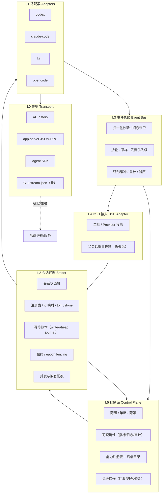
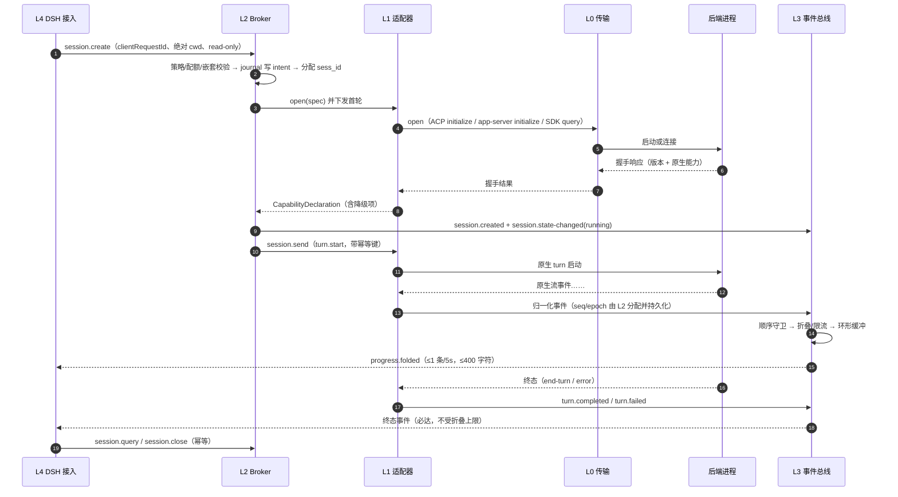

# 00 — 架构总览（MOCL 兼容层）

> 本文回答「兼容层长什么样、为什么这么切、DEC-1 怎么定」，是 `docs/architecture/01-layers.md`（逐层契约）、`02-state-machine.md`（状态与恢复）、`03-failure-modes.md`（失败与降级）的总入口。
> 协议字段/能力位/事件/错误码的唯一定义在 `docs/abi/abi-v0.md`；本文只引用，不复制。
> **写域边界**：DSH 接入细节（seam 改造、插件配置、启用步骤）属 `docs/integration/*`（D6）；每后端原生字段映射属 `docs/adapters/*`（D5）。本文不写这两类内容。

## 1. 范围

MOCL 是位于 **DSH 与四个外部编码智能体（codex / claude-code / kimi / opencode）之间**的兼容层，职责只有四件事：

1. 把「后端会话」变成**统一可寻址、可续接、可中断、可观测**的逻辑会话；
2. 把「四套原生事件」归一化成一条**有界、可折叠、可重放**的事件流；
3. 把「四套失败形态」归一化成**一棵错误分类树 + 固定降级路径**；
4. 对上层只暴露一个 **ABI**，使新增后端 = 新增 L1 适配器，不改 L2/L3/L4。

不做：GUI 视觉、DSH 核心改造、后端产品自身功能、跨后端会话迁移（v0 非目标）。

## 2. 事实基线（架构的直接输入）

| 事实 | 对架构的强制含义 | 证据 |
|---|---|---|
| 四后端的可编程面互不相同：kimi = ACP over stdio；opencode = ACP + v2 HttpApi（中断/权限应答/切模型只在 HTTP 面）；codex = app-server JSON-RPC；claude-code = Agent SDK（in-process，拉起 CLI 子进程） | **L0 必须多绑定**（含 opencode 双通道），ABI 不能长在任一传输上 | `docs/research/{kimi,opencode,codex,claude-code}.md` |
| 外部后端在 DSH seam 里是「一次执行、拒绝后续输入」，`send_message`/冷恢复只对本地 `mode: continuable` 生效 | 会话连续性必须由兼容层**自管**（Broker 拥有会话真相），不能寄望 seam 外部条目 | `docs/integration/00-dsh-integration.md` §1 |
| ACP 会话本身可续接（kimi `session/load`、opencode `session/load`），但能力参差：kimi 无中断（`session/cancel` → -32601）、opencode ACP 无 `session/set_model`、opencode ACP 只暴露 build/plan 两个 mode | **能力位协商 + 降级表**是必需品，不是锦上添花 | kimi.md §3.6/§5-5、opencode.md §3.4/§5-6 |
| codex 双版本并存（bundle 0.153.4 / PATH 0.164.0），协议为增量兼容但字段有差异 | L1 必须**钉住版本并握手断言**；L2 必须能处理 `protocol.version-mismatch` | codex.md §1/§6-1 |
| claude CLI 与 Agent SDK 是两条升级线，`persistSession:false` 会直接掐死 resume/fork | 会话持久化是 L1 的**显式配置项**，不是默认行为 | claude-code.md §6-1/§6-2 |
| 部分后端无 OS 级沙箱（kimi/opencode 实测否定），默认权限全放行 | 安全默认必须由**外层策略**（只读档 + worktree）兜底 | kimi.md §4-10、opencode.md §5-9 |
| 父会话只增不改（KV cache）；token 级事件可极密（kimi 一句思考 161 条 fragment） | L3 必须**折叠/限流/丢弃优先级**，L4 只追加 | 需求基线 §6-3、kimi.md §5-6 |

## 3. DEC-1 决策：内部 ABI 自研 + 传输层按后端选择

### 3.1 问题

> 兼容层的「主协议」应该是什么？
> - 方案 A：**ACP 为主 + 原生协议补充**
> - 方案 B：**纯原生协议 + 自研统一 ABI**
> - 方案 C：**全 ACP 统一**（非 ACP 后端各写一个 ACP bridge）

### 3.2 方案定义与差异

| 维度 | A：ACP 为主 + 原生补充 | B：原生协议 + 自研 ABI（**推荐**） | C：全 ACP 统一 |
|---|---|---|---|
| 传输面数量 | ACP + codex app-server + claude SDK（3 套，opencode 另需 HTTP 备面） | 同 A（3 套 + opencode HTTP 通道） | 仅 ACP（但需 2 个自写 bridge） |
| 语义归一化位置 | ACP 语义为主，原生差异靠 `_meta` | **ABI 层统一**（显式表） | ACP 语义 + 各 bridge 私有 `_meta` |
| 会话连续性的归属 | 依赖 ACP `session/load`（codex/claude 需补充） | Broker 自管（明确写进状态机） | 依赖 ACP `session/load` |
| 新增后端成本 | 中（需要理解 ACP + ABI 两套） | **低**（只写 L1 映射） | 中高（必须实现 ACP server） |
| 调试/可观测 | 需同时懂 ACP 与私有扩展 | **单一 ABI 事件/错误表** | ACP 工具链可用，但私有扩展不可控 |
| 风险 | 两套语义并存，长期漂移 | 自研协议维护成本 | 上游 ACP 变动直接穿透；bridge 成为第二适配器 |

### 3.3 推荐：方案 B —— 内部 ABI 自研，传输层按后端选择

**推荐形态**（即 DEC-1 预期答案的精确化）：

- **ABI 是语义契约**：会话身份、状态机、能力位、事件、错误、幂等、父会话增量上限（`docs/abi/abi-v0.md`）。
- **传输层按后端选择**（与 `docs/research/capability-matrix.md` §2 选型一致）：kimi → ACP over stdio；opencode → **ACP + v2 HttpApi 双通道**（中断/权限应答/切模型只在 HTTP 面）；codex → app-server JSON-RPC；claude-code → Agent SDK。允许声明备通道（kimi/opencode 的 CLI stream-json）。
- **对外可选 ACP facade（二期）**：若将来需要被第三方 ACP 客户端复用，可把 ABI 投影成 ACP server；但**内部不以 ACP 为唯一 seam**，避免过早绑定。

理由（按权重排序）：

1. **语义收敛点必须在「会话」而不是「传输」**：真正要统一的是会话身份/续接/中断/权限应答/事件粒度/错误形态六件事，它们分布在三个不同传输里；把收敛点放在 ABI，才能让 codex 与 claude 不被降级成「ACP 二等公民」。
2. **能力位是硬需求**：kimi 无中断、opencode ACP 无 `set_model`、claude 默认不持久化 → 必须有统一的「native/emulated/unavailable + 降级路径」声明面（abi-v0 §3.5）。ACP 的 `agentCapabilities` 只覆盖部分，且各家私扩 `_meta` 不可控。
3. **幂等/去重只有 Broker 能做**：ACP 无跨进程幂等键语义；app-server 的 request id 只解决链路关联。要让「父级重试不产生第二轮」成立，必须在 L2 有账本（abi-v0 §9）。这层与传输无关，只能自研。
4. **可观测与排障成本**：单一事件表/错误表意味着日志、指标、UI 数据面、测试断言可以复用；三套原生协议各自排障会让维护成本随后端数线性增长。
5. **演进可控**：ABI MAJOR/MINOR 规则（abi-v0 §13）让「新增后端」与「上游协议变更」解耦；ACP 上游仍在演进（kimi/opencode 的 `_meta` 互不相同），直接依赖等于把上游风险引到产品面。

### 3.4 反方理由（对推荐的实质性反驳，逐条回应）

> 评审若只看到推荐会认为「自研协议 = 重复造轮子」。以下每条都是真问题，不回避。

| # | 反方论点 | 强度 | 回应（为什么仍坚持，以及如何缓解） |
|---|---|---|---|
| N-1 | **重复造 ACP**：ACP 已经定义了 session/new/load/list/fork/prompt/cancel/set_mode/request_permission 与 fs/terminal 反向方法，自研 ABI 等于再写一遍，社区工具（编辑器、IDE、其他 agent）无法复用 | 高 | 承认重复。缓解：ABI 的方法名/语义**有意对齐 ACP 概念**（create≈new、resume≈load、list≈list、fork≈fork、respond≈request_permission 应答），并在二期提供 ACP facade；内部仍保留 ABI，因为它承载 ACP 没有的三件事（幂等账本、fencing epoch、错误分类树）。若二期 facade 被验证可用，可把「内部 ABI」降级为「facade 之下的实现细节」。 |
| N-2 | **三套传输 = 三倍测试矩阵**：ACP、app-server、SDK 的握手/超时/取消语义都不同，故障注入 ×3 | 高 | 承认。缓解：L0 只暴露 7 个原语（open/request/notify/onNotification/onReverseRequest/close/health），L1 之上所有测试复用同一套 ABI 契约测试；后端差异被压进 L1 的映射表（D5），L2/L3 测试用 mock adapter，矩阵不乘 3。 |
| N-3 | **自研协议会漂移**：没有外部实现方，字段语义容易在施工中悄悄变形，文档与代码脱节 | 中 | 缓解：能力位/事件/错误码三张表 + JSON Schema + ABI 一致性测试（abi-v0 §14 ABI-T1..T8）把契约变成可执行断言；CI 强制 `check_docs.py abi` + schema 自检。 |
| N-4 | **上层可能只需要一次性调用**：DSH seam 外部后端本来只支持一次执行；为「续接」投入 Broker+状态机可能过度设计 | 中 | 反驳：需求基线 已把「可续接/可冷恢复/进度折叠」列为目标与硬约束；且能力事实表明连续性在产品侧存在，只是 DSH 适配层关掉了。若一期只做一次性，Broker 可退化为薄封装（状态机仍是 created→running→completed），不浪费。 |
| N-5 | **ACP 是事实标准，越晚靠拢越贵** | 中 | 部分接受：所以选择「ABI 语义对齐 ACP + 二期 facade」，而不是另造一套完全不同的概念；同时把 ACP 作为 kimi/opencode 的**首选传输**，让两条腿都保留。 |
| N-6 | **自研 ABI 需要自己实现权限应答/反向请求**，而 ACP 已有 `session/request_permission` 语义 | 低 | 反驳：反向请求本来就是**传输层义务**（abi-v0 §4 第 1 条），ABI 只定义归一化事件 `permission.requested/resolved`；无需自造传输，只需把各传输的反向请求映射到同一对事件。 |

**结论**：反方论点成立的部分集中在「重复造 ACP」与「测试矩阵」，已用「语义对齐 + 二期 facade + L0 七原语收敛 + mock adapter 测试」缓解；不成立的部分（幂等/降级/fencing 必须自研）恰是 ACP 的空白。

### 3.5 「全 ACP 统一」方案的失败条件（可观测判据）

> 以下任一条件成立，说明方案 C 不可行（或已破产）。写在这里是为了让后续评审**可以判伪**，而不是凭偏好争论。

| # | 失败条件 | 判据/证据形态 | 当前证据 |
|---|---|---|---|
| F-1 | codex 没有官方 ACP 面，必须自写 codex→ACP bridge | 需要 bridge 代码；bridge 要重新实现 `thread/resume`、`turn/steer`、`turn/interrupt`、`collabAgentToolCall` 语义 | 本机 codex 可编程面是 app-server（codex.md §2/§3），未发现 ACP server 子命令 |
| F-2 | claude-code 没有 stdio JSON-RPC ACP 面，必须自写 SDK→ACP shim | shim 需重编码 `resume/forkSession/hooks/partial messages`；shim 自身成为第二个适配器 | claude-code.md §3：可编程面是 Agent SDK（in-process）与 CLI stream-json |
| F-3 | ACP 标准方法无法表达「运行中转向/中断后保留会话」 | kimi `session/cancel` = -32601；opencode ACP cancel 未验证；`turn/steer` 无 ACP 对位 | kimi.md §3.6、opencode.md §8 |
| F-4 | ACP 事件粒度/命名无法统一，仍需一层私有归一化 | kimi token 级 `agent_*_chunk`、opencode `_meta child-session-updates`、codex `turn/plan/updated` 无 ACP 对位，只能放 `_meta` | 三家 research 文档的流事件表 |
| F-5 | 全 ACP 会抹掉后端特有优势：codex daemon/`thread/loaded/list` 跨客户端线程复用、claude in-process hooks | 需要放弃或私扩；私扩一旦被上游改字段即破坏 | codex.md §3/§6-4、claude-code.md §3 |
| F-6 | 全 ACP 引入额外一层进程（bridge/shim），恢复路径变长：崩溃恢复要在 bridge 内外各做一次会话映射 | 故障注入下恢复成功率/时延劣于直连 | 设计推论；施工期 C2/C4 可用故障注入验证 |

**如果未来 F-1/F-2 被官方 ACP server 消除**（codex/claude 提供官方 ACP 面），应触发重评估（§3.6），届时「全 ACP + ABI facade」可能成为更优解。

### 3.6 重评估触发条件

1. codex 或 claude-code 发布**官方 ACP server**（stdio JSON-RPC，且能力声明覆盖 resume/interrupt/permission），且经 1 个 turn 实测通过；
2. ABI 的 B 组能力位中 ≥10 位在 ≥3 个后端变为纯 `native`，说明传输差异已不显著；
3. 施工阶段 C2/C4 的故障注入显示「直连 + Broker」的恢复成功率低于「全 ACP + bridge」——需用数据推翻当前判断。

## 4. 分层架构

一句话职责：

| 层 | 一句话 |
|---|---|
| L0 传输 | 只负责「把字节可靠地送进去、把帧可靠地读出来」，不解释语义。 |
| L1 适配器 | 把**一个**后端的原生协议翻译成 ABI 方法与事件，并如实声明能力。 |
| L2 会话代理 | 会话真相的唯一持有者：状态机、id 映射、幂等、租约、配额、冷恢复。 |
| L3 事件总线 | 把事件变成「有序、有界、可折叠、可重放」的上行流，并按上限投影给 L4。 |
| L4 DSH 接入 | 把 ABI 投影成 DSH 能消费的形态；不拥有会话真相、不直接连后端。 |
| L5 控制面 | 配置/策略/配额/可观测/运维；横向约束所有层，不参与数据面转发。 |

## 5. 数据流

### 5.1 正常一轮（控制面 + 事件面）

### 5.2 三类数据面（不要混在一起）

| 数据面 | 内容 | 路径 | 持久性 | 上限 |
|---|---|---|---|---|
| **控制面** | 建会话/发消息/续接/中断/查询/关闭 | L4 → L2 → L1 → L0 | journal 持久化（write-ahead） | 幂等账本 7 天 |
| **事件面** | 流事件、状态、工具、权限、用量、子会话 | L1 → L2(journal) → L3 → L4 | journal 全量 + 环形缓冲（内存） | 单事件 `maxEventBytes` |
| **遥测面** | 指标、结构化日志、审计 | 各层 → L5 | 滚动文件/指标后端 | 采样，不含凭据 |

**硬规则**：事件面必须**先持久化后投递**（abi-v0 EV-6），否则冷恢复无法重放；遥测面**不允许**阻塞事件面（异步、有界队列、丢旧保新）。

### 5.3 写路径与读路径（只追加）

- 写路径：`intent → 执行 → commit`（journal append-only；映射表是 journal 的物化视图，可重建）。
- 读路径：`query/list` 读物化视图；事件读 journal + 环形缓冲；两者都可带 `consistentWithSeq` 做读己之写。
- 恢复路径：`journal + 后端探测` 对账，禁止「猜已发送」。

## 6. 部署形态

| 形态 | 结构 | 适用 | 优点 | 代价 |
|---|---|---|---|---|
| **P1 单进程旁路插件（一期默认）** | Broker + Bus + 适配器全在 DSH 插件进程内；后端各自子进程 | 单窗口、单 DSH 会话 | 改动面最小；无跨进程协议 | 进程崩溃丢内存态（靠 journal 冷恢复）；DSH 退出即会话不可续（除 P2） |
| **P2 常驻 Broker daemon + 本地 socket** | Broker/Bus 独立常驻；DSH 插件是薄客户端 | 多窗口、跨 DSH 会话复用、长时间任务 | 会话跨 DSH 重启存活；可做「外部后端可续接」 | 多一个进程/端口/租约；需要 fencing 防双写 |
| **P3 后端常驻服务复用** | L0 复用 codex `app-server daemon`、opencode 后台 service | 降启动延迟、共享 loaded threads | 冷启动快；跨客户端共享会话 | 状态耦合到后端服务；版本/凭据问题会全局放大 |
| **R1（拒绝）每会话一 daemon** | 每个子代理一个常驻服务 | — | 隔离好 | 资源爆炸、恢复复杂、与 DSH 8 并发上限冲突 |
| **R2（拒绝）全 ACP 单网关** | 所有后端经 ACP bridge | — | 只维护一套传输 | §3.5 失败条件 F-1..F-6 |

选型规则：一期用 **P1**；需要「DSH 重启后继续同一外部后端会话」时升级 **P2**；P3 只在实测证明 daemon 稳定且不引入凭据共享风险后启用。

## 7. 组件职责边界（防止写域串味）

| 层/组件 | 拥有 | 明确不拥有 | 详细文档（写域） |
|---|---|---|---|
| L0 传输 | 进程/连接生命周期、帧、超时、反向请求通道 | 会话语义、能力判断、重试策略 | 本文 §4 + D5 适配规格的「启动与握手」 |
| L1 适配器 | 单后端映射表、能力声明、反向请求应答、原生错误归类 | 状态机、幂等账本、配额、父会话呈现 | `docs/adapters/*`（D5） |
| L2 Broker | 会话真相、状态机、映射、幂等、租约、恢复、配额 | DSH 语义、UI 呈现、后端细节 | `02-state-machine.md` + `01-layers.md` §L2 |
| L3 总线 | 顺序、去重、折叠、限流、背压、重放 | 业务决策（是否继续/是否终止） | `01-layers.md` §L3 |
| L4 DSH 接入 | ABI→DSH 投影、父会话增量载体、工具 schema | 会话真相、后端连接、恢复算法 | `docs/integration/*`（D6） |
| L5 控制面 | 配置 schema、策略、配额、指标、审计、运维命令 | 数据面转发 | `docs/integration/01-config-and-enable.md` + `docs/risk/*` |

## 8. 横切设计（全层强制）

| 关注点 | 规则 | 依据 |
|---|---|---|
| 幂等 | 写操作必带 `clientRequestId`；副作用至多一次；重复调用返回缓存结果 | abi-v0 §9 |
| fencing | 每次恢复/接管 `epoch+1`；旧 epoch 的写与事件一律丢弃 | 02-state-machine §5 |
| 容量 | 并发/嵌套/事件字节/父会话增量四类上限都必须有默认值且可配 | 需求基线 §6-4 |
| 安全默认 | `read-only` 为默认档；`yolo` 必须显式 + worktree 隔离 | 需求基线 §6-5 |
| 只追加 | 父会话前缀不可改写；增量可折叠不可回滚 | 需求基线 §6-3 |
| 可观测 | 每层输出结构化诊断；错误必带 `traceId`；指标口径统一 | 01-layers §6 |
| 版本 | ABI 版本协商 + 后端版本断言；失配快速失败 | abi-v0 §2/§13 |
| 无人值守 | 所有反向请求必须有确定性应答；无 handler = fail-closed | abi-v0 §10 SEC-3 |

## 9. 与 需求基线 成功标准的映射

| 标准 | 本文/关联文档中的证据点 |
|---|---|
| A2（架构含分层/数据流/状态机/失败模式/部署） | 本文 §4/§5/§6；`02-state-machine.md`；`03-failure-modes.md` |
| A3（ABI 含 schema/版本协商/错误分类/能力位） | `docs/abi/abi-v0.md` §2/§3/§8；`docs/abi/schema/*.json` |
| 需求基线 硬约束 3（父会话只增量） | §5.2 + abi-v0 §11 + 01-layers §L3/L4 |
| 需求基线 硬约束 4/5（成本与安全默认） | §6 部署形态 + §8 横切 + 03 失败模式（429/额度/并发） |
| DEC-1 | §3（推荐 + 反方 + 全 ACP 失败条件 + 重评估触发） |

## 10. 非目标与未决

**非目标（v0）**：跨后端会话迁移；把 DSH 核心改成 continuable；多租户/多用户隔离；GUI；性能压测；ACP facade 实现（二期）。

**未决（交给施工切片）**：

| ID | 未决 | 归属 |
|---|---|---|
| AR-V1 | P2 常驻 Broker 的部署与租约细节（是否一期就要） | C2/C8 |
| AR-V2 | P3 复用 codex daemon 时「多 DSH 会话共享 loaded thread」的隔离边界 | C4/C9 |
| AR-V3 | 父会话增量在 DSH 中的载体（工具返回值 vs 通知）——本文只定义上限与折叠产出 | D6 |
| AR-V4 | 子代理嵌套上限的默认值（codex 本机 `max_depth=2`；其他后端无硬上限） | D6/C2 |
