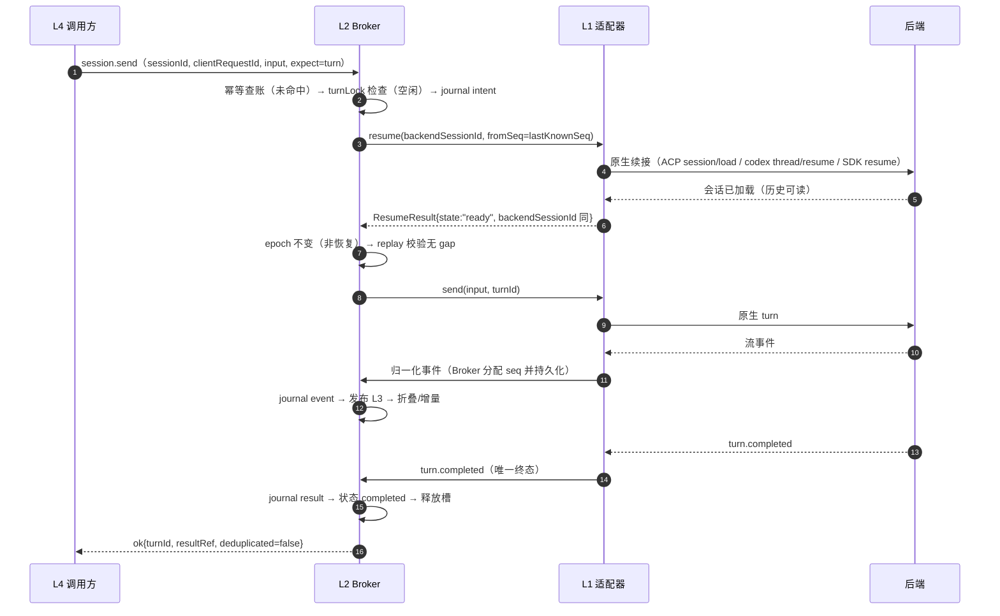
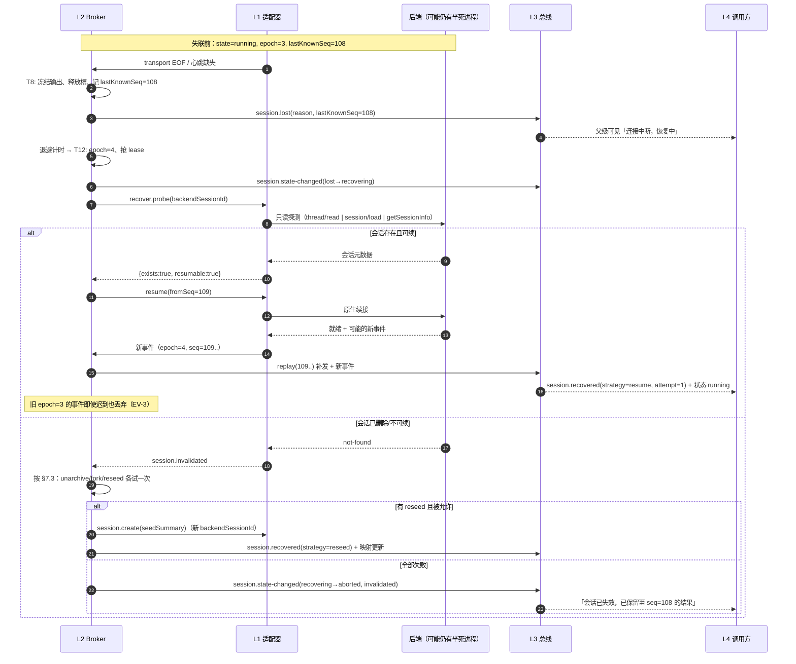
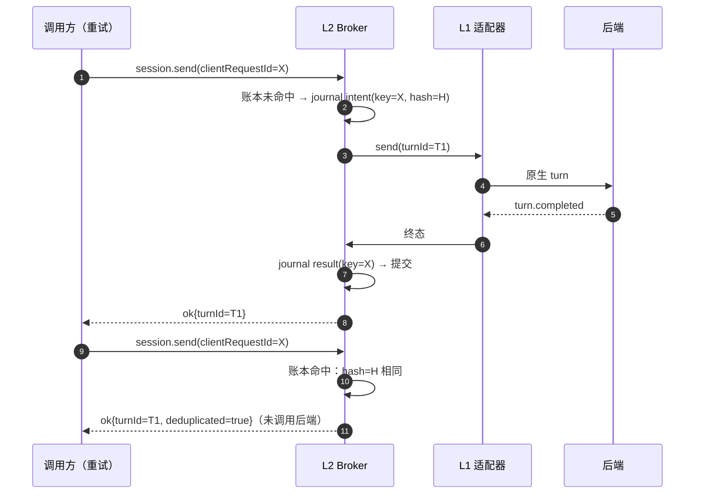

# 02 — 会话状态机、幂等与冷恢复

> 状态/转移是 L2 会话代理的内部契约（`docs/architecture/01-layers.md` §L2），对外体现为 `session.state-changed` 事件与 `session.query` 的状态字段。
> 状态枚举、事件名、错误码、幂等键语义以 `docs/abi/abi-v0.md` 为准（§5 事件模型、§6 方法、§8 错误码、§9 幂等）。
> 本文回答四个必答问题：**重复发送、崩溃后恢复、产品侧会话已被删除、映射表损坏**（§7）。

---

## 1. 状态模型（三层正交）

一个会话同时有三个正交维度，**不要混用**：

| 维度 | 取值 | 归属 | 用途 |
|---|---|---|---|
| **生命周期状态**（`state`） | `created` / `running` / `awaiting-input` / `blocked` / `completed` / `aborted` / `lost` / `recovering` / `archived` | 会话本身 | 外部查询、父级呈现、转移守卫 |
| **激活状态**（`activation`） | `inactive` / `queued` / `active` / `draining` | 并发槽位 | 容量控制（与 DSH `maxActiveSubagents` 语义对齐，但不混同） |
| **轮次状态**（`turn.state`） | `accepted` / `running` / `awaiting-input` / `completed` / `failed` / `aborted` | 单轮 | 幂等、中断、结果归属 |

三者关系：生命周期是「会话还活着吗」；激活是「占不占并发槽」；轮次是「这一轮在干什么」。例：`state=completed` + `activation=inactive` + 最后一轮 `turn.state=completed`。

## 2. 生命周期状态定义

| 状态 | 语义 | 是否终态 | 持有资源 | 可续接 | 父级可见 |
|---|---|---|---|---|---|
| `created` | 逻辑会话已登记，后端会话/首轮尚未确认 | 否 | 槽位（queued/active）、握手连接 | 否（尚未可续） | 「已创建，启动中」 |
| `running` | 有一轮正在执行（或刚接受） | 否 | 槽位 active、连接、turnLock | 是 | 「运行中」 |
| `awaiting-input` | 等待权限/人工输入（无人值守下多为瞬时态） | 否 | 槽位 active、连接 | 是 | 「等待确认/输入」 |
| `blocked` | 需要外部决策（额度、策略、orphan、人工修复）才能继续；**不自动重试** | 否 | 槽位（受 blockTtl 限制） | 视原因 | 「已阻塞：<原因>」 |
| `completed` | 正常结束，结果已交付/可取 | **是** | 释放槽位；journal 保留；连接可关 | 是（`multiTurn`/`resumeSession`） | 「已完成」 |
| `aborted` | 被中断、失败或不可恢复 | **是** | 释放槽位；保留事件与部分结果 | 否（除非 reseed 新建） | 「已终止：<原因>」 |
| `lost` | 与后端失联，终态未知 | 否 | 释放槽位；lease 过期 | 待恢复 | 「连接中断，恢复中」 |
| `recovering` | 正在探测/重连/重放 | 否 | 新 epoch 的 lease | 进行中 | 「恢复中」 |
| `archived` | 已归档（用户/运维/保留期） | **是** | 无运行时资源；tombstone 保留 | 否（需 fork/reseed） | 「已归档」 |

终态不可回退（`completed`/`aborted`/`archived`）；`archived` 可从任一终态进入，也可从 `blocked`（保留期清理）进入。

**中文 ↔ 英文状态对照**（BRIEF/评审用中文，ABI/代码用英文；只此一套映射）：

| 中文 | 英文枚举 | 说明 |
|---|---|---|
| 新建 | `created` | 已登记，后端未就绪 |
| 运行 | `running` | 有进行中轮 |
| 等待输入 | `awaiting-input` | 等权限/人工输入 |
| 阻塞 | `blocked` | 等外部决策（额度/策略/orphan） |
| 已完成 | `completed` | 正常终态 |
| 已取消/已中止 | `aborted` | 中断/失败/不可恢复的终态（BRIEF 的「已取消」并入此态） |
| 失联 | `lost` | 终态未知，待恢复 |
| 恢复中 | `recovering` | 探测/重连/重放 |
| 已归档 | `archived` | 终态，保留 tombstone |

## 3. 激活状态（并发槽）

| 激活态 | 含义 | 进入条件 | 退出条件 | 与生命周期关系 |
|---|---|---|---|---|
| `inactive` | 不占槽 | 终态、排队前、`lost` 后 | 获得槽位 | 终态会话必为 inactive |
| `queued` | 已登记，等待槽位/后端配额 | 到达并发上限（`limit.concurrency-exceeded` 的可重试路径） | 获得槽位 → active；超时/取消 → aborted | 通常 `state=created` |
| `active` | 占用一个并发槽 | 握手成功 + 轮次被接受 | 轮次结束/失联/阻塞超时 | `running`/`awaiting-input` |
| `draining` | 不再接受新轮次，等待当前轮自然结束/中断 | close/archive 请求到达但轮次进行中 | 轮次结束 → inactive | `running` 但不再接受新 send |

**不变量**：`active + draining` 数量 ≤ `maxConcurrentTurns`；`queued` 不得被计为 active（否则死锁）；槽位释放必须幂等（重复 release 不报错、不减计数）。

## 4. 状态转移图

```mermaid
stateDiagram-v2
    [*] --> created: T1 create.intent
    created --> running: T2 handshake-ack + first-turn accepted
    created --> aborted: T3 spawn/handshake fatal
    created --> lost: T17 handshake EOF/timeout
    running --> awaiting-input: T4 permission/input requested
    awaiting-input --> running: T5 respond/auto-policy
    awaiting-input --> aborted: T22 interrupt/input-timeout
    running --> completed: T6 turn.completed
    running --> aborted: T7 interrupt/fatal failure
    running --> blocked: T9 unrecoverable-without-decision
    running --> lost: T8 lease-expired/EOF/crash
    running --> running: T23 steer self-transition
    blocked --> running: T10 unblock
    blocked --> aborted: T11 operator give-up/blockTtl
    blocked --> archived: T20 retention purge
    lost --> recovering: T12 recover trigger
    lost --> aborted: T21 strategy=abort
    recovering --> running: T13 resume/fork/reseed success + replay
    recovering --> aborted: T14 all strategies failed
    recovering --> blocked: T15 transient backend unavailable
    completed --> archived: T18 archive/retention
    aborted --> archived: T19 archive/retention
    archived --> [*]: T24 tombstone GC
```

## 5. 转移表（触发 / 守卫 / 副作用 / 幂等）

> 幂等键格式：`state:{sessionId}:{transitionId}:{causeId}`；`causeId` 为触发该转移的 `clientRequestId` / `eventId` / `attempt`。**同一转移键重复到达 → 直接返回已落库结果**，不重复执行副作用。

| # | From → To | 触发 | 守卫（全部满足才执行） | 副作用（按序） | 幂等键 | 发出事件 |
|---|---|---|---|---|---|---|
| T1 | ∅ → `created` | `session.create` | 后端已注册；配额/嵌套未超；`cwd` 绝对且在允许根内；能力档案可满足 `requiredBits`（否则握手期 fail） | ① journal `create-intent` ② 分配 `sess_id` ③ 快照配置 ④ 抢槽（queued/active）⑤ L1 `open()` ⑥ journal `create-ack` | `create:{backendId}:{clientRequestId}` | `session.created` |
| T2 | `created` → `running` | 握手成功 + 首轮被接受 | 首轮存在；`turnLock` 空闲；能力快照未失效 | ① 回填 `backendSessionId` ② 建 turn 记录（accepted→running）③ 写 `send-ack` ④ 计时器（`maxTurnMs`） | `send:{sessionId}:{clientRequestId}` | `turn.started` + `session.state-changed` |
| T3 | `created` → `aborted` | 握手/spawn 致命失败 | 无重试路径（或重试已耗尽） | ① journal `state=aborted` ② 释放槽 ③ 关闭连接 ④ tombstone（可恢复保留） | `state:{sessionId}:T16:{attempt}` | `session.state-changed`（error 附 `error.code`） |
| T4 | `running` → `awaiting-input` | `permission.requested` / `input.requested` | 请求来自当前 `turnId`；未被自动策略即时应答（否则不进本状态） | ① 记 pending request ② 启动 `inputTimeoutMs` ③ 保留 lease | `state:{sessionId}:T4:{requestId}` | `permission.requested` / `input.requested` + `session.state-changed` |
| T5 | `awaiting-input` → `running` | `session.respond` / 自动策略结论 | `requestId` 仍在 pending；决策合法 | ① 清除 pending ② 发 resolved 事件 ③ 重置 idle 计时 | `respond:{sessionId}:{clientRequestId}` | `permission.resolved` 或 `input.resolved` + `session.state-changed` |
| T6 | `running` → `completed` | `turn.completed` | 该轮唯一终态；结果已提交 journal | ① 写 result ② 释放 active 槽（→inactive）③ 结束计时 ④ 轻量保留连接（可关） | `state:{sessionId}:T6:{turnId}` | `turn.completed` + `session.state-changed` |
| T7 | `running` → `aborted` | `session.interrupt` 成功 / `turn.failed` fatal | 该轮未终态 | ① 记 `interruptMethod` ② 保留部分结果（`partial`）③ 释放槽 ④ 关连接（按需） | `interrupt:{sessionId}:{clientRequestId}` 或 `state:{sessionId}:T7:{turnId}` | `turn.aborted` 或 `turn.failed` + `session.state-changed` |
| T8 | `running` → `lost` | lease 过期 / EOF / 进程崩溃 / 心跳超时 | 无该轮终态事件；失联判定窗口已过（默认 30s） | ① 冻结输出 ② 释放 active 槽 ③ 启动恢复计时（`recoveryWindowMs`）④ 记录 `lastKnownSeq` | `state:{sessionId}:T8:{leaseId}` | `session.lost` + `session.state-changed` |
| T9 | `running` → `blocked` | 运行期能力缺口 / 额度耗尽 / 存储只读 / orphan | 策略为「暂停等待决策」而非「立即终止」 | ① 停止接受 send ② 记 `stateReason` ③ 保留槽位（≤`blockTtlMs`）④ 告警 | `state:{sessionId}:T9:{causeId}` | `session.state-changed`（带 `error`） |
| T10 | `blocked` → `running` | 外部修复后 `session.resume` / 同键重试 | 阻塞原因已消除（策略/额度/存储恢复）；能力重新探测通过 | ① 重新校验能力 ② 重置计时 ③ 若原轮未终态则先对账 | `recover:{sessionId}:{clientRequestId}` | `session.state-changed` (+`session.recovered` 若经过恢复) |
| T11 | `blocked` → `aborted` | 运维/上层放弃；`blockTtlMs` 到期 | 无强制保留要求 | ① 释放槽 ② 写终止原因 ③ tombstone | `state:{sessionId}:T11:{causeId}` | `session.state-changed` |
| T12 | `lost` → `recovering` | 恢复计时触发 / 显式 `session.recover` | 未归档；尝试次数 ≤ `maxRecoveryAttempts`（默认 5）；未超出 `recoveryWindowMs` | ① `epoch+1` ② 抢 lease ③ 记录 recovery attempt ④ 探测后端（只读优先） | `recover:{sessionId}:{epoch}` | `session.state-changed` |
| T13 | `recovering` → `running` | `resume`/`fork`/`reseed` 成功 + 重放到 `fromSeq` | 探测到的会话与映射一致；重放无不可解释 gap | ① 更新映射（fork/reseed 会有新 backendSessionId）② 重放补发事件 ③ 重置计时 ④ 发 recovered | `recover:{sessionId}:{epoch}` | `session.recovered` + `session.state-changed` |
| T14 | `recovering` → `aborted` | 策略耗尽（resume/fork/reseed 全失败）或 `strategy=abort` | — | ① 写 `terminalReason`（invalidated/failed）② `preservedThroughSeq` ③ 释放资源 | `recover:{sessionId}:{epoch}:final` | `session.state-changed` |
| T15 | `recovering` → `blocked` | 后端暂时不可用（429/额度/维护） | 仍可恢复，但需等待 | ① 记 `stateReason` ② 保留 tombstone/映射 ③ 定长等待 | `state:{sessionId}:T15:{causeId}` | `session.state-changed` |
| T17 | `created` → `lost` | 握手 EOF/超时 | 进程已拉起但握手未完成 | ① 冻结 ② 释放槽 ③ 进入恢复（同 T12 守卫） | `state:{sessionId}:T17:{attempt}` | `session.lost` |
| T18 | `completed` → `archived` | `session.close(archive=true)` / 保留期 | 已终态；无进行中轮 | ① 后端 archive（若有 `sessionArchive`）② 关连接 ③ journal `archive` ④ 保留 tombstone | `archive:{sessionId}:{clientRequestId}` | `session.archived` |
| T19 | `aborted` → `archived` | 同上 | 同上 | 同上 | 同上 | 同上 |
| T20 | `blocked` → `archived` | 保留期清理 | 超过 `blockTtlMs` 且无人工保留标记 | ① 关连接 ② tombstone ③ 审计 | `archive:{sessionId}:retention` | `session.archived` |
| T21 | `lost` → `aborted` | 策略 `strategy=abort` / 恢复窗口耗尽 | 恢复不可行（后端会话已删且无 reseed） | ① 写 invalidated ② 保留事件 ③ 释放 | `recover:{sessionId}:{epoch}:abort` | `session.state-changed` |
| T22 | `awaiting-input` → `aborted` | 中断 / `inputTimeoutMs` | pending 请求未应答 | ① 取消请求（若可）② 释放槽 ③ 部分结果 | `state:{sessionId}:T22:{requestId}` | `session.state-changed` |
| T23 | `running` → `running`（自转移） | `session.steer` 被接受 | `steerTurn` 可用；turnLock 持于同一轮 | ① 记录 steer 序号 ② 发事件（不改 state） | `steer:{sessionId}:{clientRequestId}` | `turn.steered` |
| T24 | `archived` → ∅ | 保留期 GC | 超过 `tombstoneRetentionMs` | ① 删除 tombstone ② 保留审计摘要 | `gc:{sessionId}` | 无（审计记录） |

**编号说明**：`T16` 原为 `created → aborted` 的重复行，已合并进 `T3`，编号**不复用**（保持外部引用稳定）。
**幂等键例外**：`session.create` 在会话 id 尚不存在时发生，其键作用域是 `create:{backendId}:{clientRequestId}`（无 `sessionId` 段）；其余写操作统一 `{method}:{sessionId}:{clientRequestId}` 或 `state:{sessionId}:{transitionId}:{causeId}`。完整规则见 `docs/abi/abi-v0.md` §9.1。

**转移合法性**：任何不在上表的 `from → to` 一律 `session.conflict`，返回当前状态；**禁止**「顺手修正」状态。

## 6. 轮次（turn）状态与锁

| 轮次态 | 语义 | 谁可写 |
|---|---|---|
| `accepted` | Broker 已落库 intent，尚未收到后端接受 | L2 |
| `running` | 后端已接受 | L1 事件驱动 |
| `awaiting-input` | 该轮等待权限/输入 | L1 事件驱动 |
| `completed` / `failed` / `aborted` | 终态，**恰好一个** | L1 终态事件 / L2 超时与中断 |

轮次规则：

- 每会话**同时最多一个非终态轮**（turnLock）；新 `session.send` 在锁被占时返回 `session.locked` + `retryAfterMs`（除非 `steerTurn`/`inputInbox` 可用且调用方选择）。
- 终态判定必须基于**后端事件**或**确定性本地终止**（超时/中断/额度）；不得用「多久没输出」直接判完成。
- 结果归属：`turn.completed` 的结果归该 `turnId`；父级查询用 `session.query.result`（只返回最后一次成功轮）。

## 7. 四个必答问题

### 7.1 重复发送（duplicate send / at-least-once 调用方）

**场景**：调用方超时重试、网络抖动重放、父级两次工具调用、恢复过程中重放旧请求。

**判定与处理**：

| 情况 | 判定信号 | 处理 | 返回 |
|---|---|---|---|
| 同 `clientRequestId` + 同载荷 | 幂等账本命中 `requestHash` 相同 | **不调用后端**；返回首次结果 | `deduplicated:true` + 原 `turnId` |
| 同 `clientRequestId` + 不同载荷 | `requestHash` 不同 | 拒绝（不覆盖旧结果） | `session.conflict` |
| 新 `clientRequestId`，turnLock 已占 | 会话有非终态轮 | 不排队（除非 `inputInbox`）；给建议等待 | `session.locked` + `retryAfterMs` |
| 并发双请求（同键） | journal 唯一约束 | 单写者串行：先到者提交，后到者读结果 | 后到者 `deduplicated:true` |
| 崩溃后重放（intent 有、result 无） | journal 状态 `started` | **先对账**：`session.query`/后端读取确认是否已产生轮次；已产生 → 补 result；未产生 → 安全重发（同键）；无法判定 → `session.conflict` | 见左 |
| 重放落在账本过期后 | `expiresAt < now` | 视为新请求（可能重复副作用）；审计告警 | 正常执行 + `session.warning` |

**证明性约束**（施工验收 ABI-T4）：在 mock 适配器上，同一 `clientRequestId` 重放 N 次，后端 `send` 调用次数必须 == 1；且返回的 `turnId` 全等。实现要点：actor 内「查账本 → 写 intent → 调后端 → 写 result」全串行，账本与 journal 同一事务边界。

### 7.2 崩溃后恢复（crash / kill -9 / 断电）

**分层答案**：

| 崩溃对象 | 现象 | 恢复动作 |
|---|---|---|
| **后端子进程** | EOF/退出码非零；Broker 仍在 | L1 发 `session.lost` → Broker 走 T8→T12 冷恢复（§8） |
| **Broker 进程** | 插件/daemon 退出；journal 保留 | 重启后：① 读 checkpoint+journal 重建注册表 ② 所有非终态会话标 `lost` ③ 按 `recoverOnStartup` 逐个恢复 ④ orphan 进程按 pid+nonce+pgid 处理（能接管则接管，否则杀+恢复） |
| **宿主/断电** | journal 可能尾部半条记录 | 校验和截断到最后完整记录；事件 seq 可能有缺口 → 从 journal 重放补齐；后端侧以 `read/resume` 对账 |

**核心不变量**：

1. **write-ahead**：任何「已接受」都必须先于副作用落 journal（INV-L2-3）。崩溃后最多丢「未 ack 的请求」，绝不丢「已 ack 的请求」。
2. **对账优先于重发**：恢复时先查后端真实状态（codex `thread/read`、ACP `session/load` 后的历史、SDK `getSessionMessages`），再决定补结果或重发。
3. **fencing 防双写**：恢复者 `epoch+1`；旧进程即便复活，其写与事件因 epoch 过期被拒/丢弃（INV-L2-2、EV-3）。
4. **不产生第二次成本**：仅当确认后端**没有**执行过该轮时，才允许重发（避免「重试一次就恢复」的假设——PLAN 反例 3 明确禁止）。

**恢复时的对账矩阵**：

| 本地状态 | 后端状态 | 动作 |
|---|---|---|
| intent, 无 result | 后端显示该轮已接受/已完成 | 补写 result + 补发缺失事件（replay），不重发 |
| intent, 无 result | 后端无该轮痕迹 | 同键重发一次（幂等键不变）；仍失败 → `aborted(terminalReason=failed)` |
| committed | 后端会话不存在 | T21：`aborted(terminalReason=invalidated)`，保留事件 |
| committed | 后端会话存在 | 保持 completed；`session.resume` 可继续（若调用方要下一轮） |

### 7.3 产品侧会话已被删除（backend session deleted/archived）

**检测信号**（由 L1 映射为 `session.invalidated`）：

| 后端 | 信号（示例，具体映射见 D5） |
|---|---|
| kimi | ACP `session/load` 返回 `-32602 Invalid params: Unknown sessionId` |
| opencode | ACP `session/load` not-found；`GET /api/session/{id}` 返回 not-found |
| codex | `thread/resume`/`thread/read` 返回 not-found/已删除；`thread/list` 中消失 |
| claude-code | `getSessionInfo`/`resume` 失败；`listSessions` 缺失且落盘文件不存在 |

**处理顺序（能力驱动，禁止死循环）**：

1. **一次探测**：只读方式确认（list/read），不做写操作。
2. 若后端支持 `sessionUnarchive` 且会话是**归档**而非删除 → unarchive → 继续 T13（若当前 epoch 尚未持 lease，先补 T12 的 lease 获取）。**仅尝试一次**。
3. 若支持 `forkSession` 且会话仍可读 → 可 fork 出新会话继续（由调用方策略决定；不默认）。
4. 若支持 `sessionReseed` 且调用方授权 → 新建会话 + 交接摘要（`seedSummary`），映射更新为新 backendSessionId；父级看到「新会话」。
5. 否则 → **T21**：`aborted`，`terminalReason=invalidated`，`result.status=partial`，`preservedThroughSeq=lastKnownSeq`；父级收到一次 `session.state-changed`（error）与 `userMessage`「会话在后端已失效，无法续接」。
6. **禁止**：自动循环 resume、自动重开新会话（除非显式策略 `recovery.onSessionGone=reseed`）、把「删除」当「网络错误」重试。

**与「归档」的区别**：产品侧归档（可 unarchive）≠ 删除（不可恢复）。ABI 用 `session.invalidated` 统一分类，但 `details.hint` 区分 `archived` / `deleted`，供 L4 呈现不同文案。

### 7.4 映射表损坏（registry corruption）

**设计前提**：**映射表 = journal 的物化视图**，不是独立真相。任何时刻都可以从 journal + 后端探测重建。

**损坏形态与处置**：

| 形态 | 检测 | 处置 |
|---|---|---|
| journal 尾部半条/校验和失败 | 逐条 checksum | 截断到最后有效记录；重建视图；丢失的尾部操作视为未发生（未 ack 的不对外承诺） |
| 映射条目缺失 | 视图与 journal 不一致 | 全量重建（`rebuildRegistry()`），重建期间只读 |
| 一个 `backendSessionId` 对应多个 `sess_id` | 唯一性约束 | 全部标记 `blocked(stateReason=orphan-mapping)`，停止调度，等待 `admin.repair`；**不猜** |
| 一个 `sess_id` 匹配到多个后端会话 | 匹配歧义（title/metadata/cwd/时间窗） | 同上，隔离为 orphan；不自动 attach |
| 快照损坏 | 快照校验和 | 丢弃快照，从 journal 起点重建（慢但确定） |
| journal 本身损坏到不可解析 | 连续坏记录 | **fail-closed**：Broker 进入只读，拒绝新会话；导出可读前缀供人工修复；`session.mapping-corrupt` |

**重建匹配证据（按置信度降序，只有强证据才允许自动 attach）**：

1. journal 中记录过的 `backendSessionId`（强证据，唯一匹配才 attach）；
2. 后端会话 metadata/title 中写入的 `moclSessionId`（适配器握手时注入；强证据）；
3. `cwd` + 创建时间窗 + 首次 prompt 摘要哈希（中证据；**仅用于人工核对提示**，不得自动 attach）；
4. 会话标题相似度（弱证据；**禁止**用于 attach）。

**修复接口（L5 运维）**：`admin.repair(sessionId, {backendSessionId, evidence, operator})` → 写审计 + journal `repair` 记录 + 解除 orphan；修复前该会话所有写操作返回 `session.mapping-corrupt`。

## 8. 冷恢复算法（`session.recover`）

### 8.1 触发

- `lost` 后计时器（默认 2s 首次，指数退避）；
- Broker 重启扫描（`recoverOnStartup=true` 时）；
- 调用方显式 `session.recover`；
- 运维 `admin.recover`。

### 8.2 策略阶梯（`strategy=auto`）

```text
1) resume   ：读后端会话（read/load/getMessages）→ 校验同一会话 → 续接 + 重放
2) fork     ：仅当调用方要求隔离或 resume 不可用但有 fork 能力
3) reseed   ：仅当调用方/配置允许，且能生成交接摘要（新会话，成本显式）
4) abort    ：以上不可行 → aborted(invalidated/failed)，保留事件
```

**能力缺失不报错**：若 `resumeSession=unavailable`，直接跳过 1，走 2（若有 fork）或 3（若有 reseed）或 4；全程返回结构化 `recovery.strategy` 与 `substitutions[]`（abi-v0 §3.5 R-1）。

### 8.3 恢复步骤（幂等，任意步可重入）

1. **加锁**：`recover:{sessionId}:{epoch}` 去重；抢 lease（`epoch+1`）；失败 → `session.locked`。
2. **幂等前置检查**：若已有同 epoch 的恢复结果 → 直接返回（不重复探测）。
3. **只读探测**：按后端能力选择 `thread/read|loaded/list`、ACP `session/load`、SDK `getSessionInfo`；确认后端会话是否存在、是否同一会话（匹配 `moclSessionId` 或 journal 记录）。
4. **判定**：存在 → 续接；不存在 → §7.3 处理；不可判定 → `blocked(orphan-mapping)`。
5. **重连/重建**：`resume` 建绑定；`fork` 新建并记录映射；`reseed` 通过 `session.create(firstInput=seedSummary)` 新建。
6. **重放**：`session.replay(fromSeq=lastKnownSeq+1)`，把 journal/环形缓冲中缺失事件补发给 L4；同时与后端新事件对账去重。
7. **提交**：journal `recovery-result`；状态 `recovering → running`；发 `session.recovered` + `session.state-changed`。
8. **失败**：按策略阶梯下降；每级最多 1 次；总尝试 ≤ `maxRecoveryAttempts`（默认 5，退避 1s/2s/4s/8s/16s ±20% 抖动）；耗尽 → T14。

### 8.4 退避与熔断

| 条件 | 动作 |
|---|---|
| 后端 429 / 5xx 类 | 尊重 `Retry-After`；退避重试（不消耗 resume 尝试次数，但计入时间窗） |
| 连续 `maxRecoveryAttempts` 失败 | 会话 T14 `aborted`；该后端进入半开熔断（L5 `admin.breaker`），新会话降级/拒绝 |
| 恢复中收到旧 epoch 事件 | 丢弃 + 计数（EV-3） |
| 恢复成功但重放 gap 无法补齐 | `session.warning` + 标记 `resync-required`，仍进入 running（缺失段以「不可解释 gap」呈现） |

## 9. 超时与回收

| 计时器 | 默认 | 起点 | 到期动作 | 分类码 |
|---|---|---|---|---|
| `handshakeTimeoutMs` | 30 s | T1 后 | T16/T17 | `transport.timeout` |
| `leaseTtlMs` / `heartbeatMs` | 30 s / 10 s | 每次心跳成功 | T8 | `transport.disconnected` |
| `idleTimeoutMs` | 180 s | 最近一次输出/心跳 | 探测 → 判 `process.hung` → T8 | `process.hung` |
| `maxTurnMs`（单轮） | 30 min（可配） | 轮次 accepted | 中断 → T7（`limit.turn-timeout`，保留部分结果） | `limit.turn-timeout` |
| `inputTimeoutMs` | 10 min | T4 | T22（无人值守下通常策略已即时 deny） | `policy.escalation-required` |
| `blockTtlMs` | 24 h | T9 | T11 | `session.conflict` / `session.expired` |
| `recoveryWindowMs` | 10 min | T8 | T21 | `session.resume-failed` |
| `tombstoneRetentionMs` | 30 d | 终态/归档 | T24 GC | — |
| 幂等账本保留 | 7 d | 请求提交 | 过期后可重放为新请求 | — |
| 环形缓冲 | 2048 条 / 8 MiB | 持续 | 丢旧 + 依赖 journal replay | — |

**回收（reap）规则**：L2 `reap(now)` 每 30s 扫描：① 超时计时器触发对应转移；② `blocked` 超 blockTtl → T11；③ 终态超保留期 → archive/GC；④ orphan 进程（pid+nonce+pgid 校验失败）→ kill + 审计。回收必须幂等（重复 reap 不重复转移）。

## 10. journal 与持久化

### 10.1 记录格式（append-only JSONL，可压缩）

```json
{
  "v": 1,
  "op": "send-intent|send-ack|event|state|result|create-intent|create-ack|recovery-result|archive|repair|tombstone",
  "sessionId": "sess_...",
  "epoch": 3,
  "seq": 42,
  "ts": "2026-10-25T13:54:07.123Z",
  "key": "send:sess_...:01J9Z...",
  "payload": {},
  "checksum": "sha256:..."
}
```

规则：

1. **先写后做**：`intent` 先落盘，副作用后再写 `ack/result`；崩溃后可判定「做了没」。
2. **每 1000 条或 5 分钟**做 checkpoint（物化视图快照 + 最后 seq），原子替换（临时文件 + rename）。
3. `fsync` 策略：intent/state/result 必须 fsync；event 可批量 fsync（窗口 ≤200ms），但终态事件必须立即 fsync。
4. 事件记录与状态记录同一 journal，保证「事件-状态」可一起重放。
5. GC：只删已归档且超过 tombstone 保留期的段；**禁止**压缩已发出的 seq（seq 必须单调可解释）。

### 10.2 重建流程

```text
读最新 checkpoint（校验和） → 从 checkpoint.seq+1 重放 journal 到尾部
  → 重建：会话表 / id 映射 / turn 表 / 幂等账本 / 配额计数 / 未完成 intent 列表
  → 对未完成 intent 逐个对账（§7.2 矩阵）
  → 恢复调度（§8）
```

重建期间 Broker 对写请求返回 `session.locked`（或 `storage.write-failed` 只读），读请求可服务已重建部分。

## 11. 时序图

### 11.1 续接一轮（turn N+1，进程已退出、后端会话持久化）



> 若 `resumeSession=unavailable`：第 4 步返回 `unavailable`，Broker 不报错，改走 §7.3/R-1 的 reseed 或 `aborted` 路径，并在返回的 `substitutions[]` 中声明。

### 11.2 失联后冷恢复（进程崩溃 → 恢复成功 / 失败）



### 11.3 重复发送去重（同一 `clientRequestId` 重放）



## 12. 状态机不变量（可测试断言）

| 编号 | 不变量 |
|---|---|
| SM-1 | 同一会话任意时刻最多一个非终态轮（turnLock）。 |
| SM-2 | 终态（completed/aborted/archived）不可回退；只能 → archived。 |
| SM-3 | 每次转移都发且只发一条 `session.state-changed`，且 `previousState` 与本地记录一致。 |
| SM-4 | `seq` 严格 +1；`epoch` 只增；事件先持久化后发布。 |
| SM-5 | 任何「已接受」的写请求都有 journal intent；任何有 intent 的请求在崩溃后必被对账。 |
| SM-6 | 幂等键唯一；同键不同载荷 → `session.conflict`，不得覆盖。 |
| SM-7 | 槽位释放幂等；`active+draining ≤ maxConcurrentTurns`。 |
| SM-8 | 恢复只能由持 lease 的 epoch 执行；旧 epoch 的写被拒、事件被丢。 |
| SM-9 | 映射损坏时不自动 attach；orphan 隔离且可修复。 |
| SM-10 | 产品侧会话失效时，最多做「unarchive/fork/reseed 各一次」，不得无限重试。 |

## 13. 明确否定的设计（反例）

1. **「超时就再发一次」**：写操作可能已生效，必须对账（§7.2）。PLAN 反例 3 禁止无幂等的重试假设。
2. **「失联就当完成」**：必须 `lost` + 恢复，不能伪造 `completed`。
3. **「后端会话没了就自动新建」**：默认禁止（成本与语义都变），必须显式 `reseed` 策略。
4. **「映射对不上就按标题猜」**：禁止；弱证据只能提示人工。
5. **「用内存状态当真相」**：Broker 内存态必须由 journal 可重建。
6. **「状态可随意修正」**：只能走转移表；否则 `session.conflict`。
